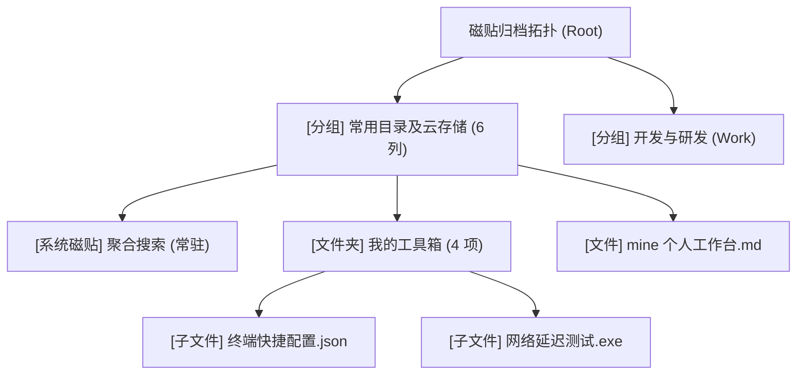
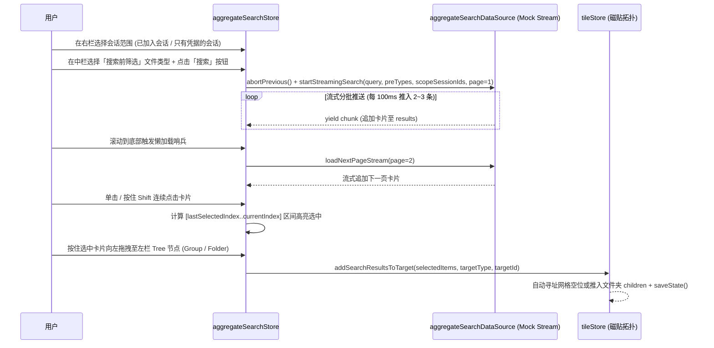

# 磁贴归档 · 聚合搜索系统前端预创建实施计划

> **状态**：已完成（纯前端预创建阶段，含标准 Mock 临时垫层，遵守 `.rules/` 接线即删与零本地 `ref` 规范，已通过 `vue-tsc` + `vite build` 验证）
> **目标模块**：`src/views/main/archive/` 与 `src/stores/archive/`

---

## 一、 需求拆解与设计对齐

| 编号 | 需求模块 | 核心设计规格 |
| :--- | :--- | :--- |
| **1** | **新增搜索应用磁贴** | 在「磁贴归档」板面新增系统内置应用磁贴「聚合搜索」，视觉表现为一个带蔚蓝微光的搜索图标（`Search`），支持 `small` (1×1)、`medium` (2×2)、`wide` (4×2)、`large` (4×4) 及自定义网格跨度（`customSpan`）。 |
| **2** | **特殊磁贴属性** | **不可删除**（右键菜单隐藏「从磁贴板移除」且 `deleteTile` 底层硬拦截；历史 `localStorage` 快照缺失或重置布局时自动补齐该磁贴）；其余特性（自由拖拽排位、跨组移动、缩放尺寸、右键重命名、点击打开）与普通磁贴完全一致；同时禁止其被拖入文件夹吞并，确保始终驻留顶层磁贴板。 |
| **3(a)** | **对话框风格** | 严格对齐文件夹弹窗（`TileFolderModal.vue`）：外层轻量压暗遮罩 `bg-black/25 backdrop-blur-[1px]`，面板本体采用深色高透亚克力 `border border-white/15 bg-[#0f172a]/70 text-white shadow-[inset_0_1px_0_0_rgba(255,255,255,0.14),0_24px_60px_-12px_rgba(0,0,0,0.6)] backdrop-blur-2xl`、1px `border-white/10` 发丝分割线与 `rounded-[2px]` 方角工业几何语言。 |
| **3(b)** | **动画、合成管线与优化** | 复用 `ArchivePlaceholderView.vue` 的 `<Transition name="archive-pop">` 管线（外层 `opacity 150ms ease`，内层 `.archive-modal-card` 采用 `transform: scale(0.94 -> 1) 160ms cubic-bezier(0.16, 1, 0.3, 1)`，离开 `120ms ease-in`）；左右分栏显隐严格遵守 `.rules/frontend-architecture.md` **无突变折叠规范**（DOM 常驻，严禁 `v-if` 销毁，通过 `width` / `opacity` / `overflow-hidden` 配合硬件加速过渡）；跨栏拖拽幽灵层仅使用 `translate3d(x, y, 0)` + `will-change: transform`。 |
| **3(c)** | **更大一圈尺寸与三栏结构** | 文件夹弹窗为 `h-[min(860px,90vh)] w-[min(1280px,94vw)]`；聚合搜索弹窗扩大一圈为 **`h-[min(960px,95vh)] w-[min(1560px,97vw)]`**（外层 `p-2.5`）。主体分为**左栏（文件树 Explorer，260px）**、**中栏（聚合搜索主栏，`flex-1`）**、**右栏（搜索范围控制：按会话维度，300px）**；顶栏 Header 提供左栏、右栏显隐切换开关。 |
| **3(d)** | **左栏：磁贴拓扑 Tree 组件** | 实时映射 `tileStore` 的三级目录拓扑：**分组（Group） → 文件夹（Folder）/ 顶层文件（File） → 文件夹内子文件（Child File）**。视觉上贴合磁贴归档页风格（详细设计见第三节），并作为拖拽落点接收中栏拖入的搜索结果。 |
| **3(e)** | **中栏 Header 与筛选菜单** | 顶部为大尺寸搜索框（**搜索按钮内嵌在搜索框右端内部**），搜索框右侧排列「筛选」图标按钮与预留 SVG 图标按钮。点击「筛选」向下伸出筛选菜单，菜单自带 Header 切换 **「搜索前」**（参与检索请求）与 **「搜索后」**（结果集二次过滤）。在「搜索前筛选」中：1. 点击「按文件类型筛选」标签罗列全部可选项；2. 点击选项切换选中态（支持多选）；3. 可选项包含：**视频、图片、会话、文本文件、其他**。 |
| **3(f)** | **流式搜索、懒加载、多选与跨栏拖拽归档** | 点击搜索后按分批流式（Streaming）渐进推入结果卡片，滚动到底部触发分页懒加载（Lazy Loading）。每张卡片**左端为正方形缩略图**，**右端为 Title 与元数据**。支持单击选择、多选高亮及 **按住 `Shift` 键连续区间多选**。支持将选中的单条或多条搜索结果**向左拖拽到左栏文件树（分组或文件夹节点）**，自动转化为磁贴加入 `tileStore` 持久化管理。 |
| **3(g)** | **右栏：搜索范围控制（按会话维度）** | 右栏负责按会话（Session）粒度控制搜索范围。右栏顶部提供专属 Header，内部划分为两类会话切换：<br>1. **第一类：已加入的会话（`joined`）** —— 列出所有已正式加入的频道、群组与私聊会话；<br>2. **第二类：只有凭据的会话（`credential_only`）** —— 列出所有未加入但本地持有访问凭据（如 `access_hash` 令牌、公开 `@username` 解析句柄、邀请预览凭据或历史归档凭据）的会话。<br>支持在两类会话下点选/多选（及全选当前分类、清空范围），选中的会话集合直接作为搜索范围参与中栏流式检索。 |

---

## 二、 架构与目录规划（遵循三层解耦与单文件精炼原则）

严格遵循 `.rules/state-management.md`（Data Source + Store + Mock 三层架构、接线即删）与 `.rules/frontend-architecture.md`（视图零本地 `ref`/`reactive`、单文件 80~150 行精炼拆分）：

```text
src/stores/archive/                        # 归档与聚合搜索业务域（标准三层架构）
├── types.ts                               # 搜索筛选类型、会话范围分类与条目 DTO、流式卡片 DTO、跨栏拖拽状态契约
├── mocks/
│   └── aggregateSearchMock.ts             # [Mock 垫层] 涵盖「已加入会话 / 仅凭据会话」列表及关联的「视频/图片/会话/文本文件/其他」五类检索池（后续接通真实后端即物理删除）
├── data-sources/
│   └── aggregateSearchDataSource.ts       # 单例接线器：按「关键词 + 搜索前类型 + 右栏选中会话范围」模拟分块流式检索 (AsyncGenerator)、AbortSignal 中止、懒加载分页、视口观察句柄
└── stores/
    └── aggregateSearchStore.ts            # 页面状态：弹窗开关、左右栏折叠态、右栏会话分类 Tab 与选中会话 ID 集、搜索词、搜索前/后筛选态、流式结果列表、Shift 多选状态机、跨栏拖拽会话

src/views/main/archive/
├── types/tile.ts                          # 扩展 systemApp?: 'aggregate-search' 与 undeletable?: boolean 属性
├── store/tileStore.ts                     # 内置「聚合搜索」特殊磁贴、防删除守卫、旧缓存自动补齐、批量从搜索结果转入分组/文件夹 Action
├── ArchivePlaceholderView.vue             # 挂载 <Transition name="archive-pop"><AggregateSearchModal /></Transition>
└── components/
    ├── tiles/
    │   └── SearchAppTile.vue              # 聚合搜索特殊磁贴渲染组件（适配 1×1 / 2×2 / 4×2 / 4×4 与自定义尺寸）
    └── search-modal/                      # 聚合搜索对话框组件树（按逻辑分栏拆分子目录）
        ├── AggregateSearchModal.vue       # 对话框顶层容器（亚克力大面板 + 三栏无突变骨架 + 跨栏拖拽浮层 Ghost）
        ├── SearchModalHeader.vue          # 弹窗顶栏（搜索应用徽标 + 标题 + 左/右栏显隐切换按钮 + 关闭按钮）
        ├── left-tree/                     # 左栏：磁贴文件目录 Explorer
        │   ├── TileExplorerTree.vue       # 左栏主容器（拓扑统计头 + 树形滚动区 + 空态/快捷新建）
        │   └── TreeBranchNode.vue         # 树节点组件（分组 / 文件夹 / 文件三级渲染 + 拖拽悬停蔚蓝光晕与自动展开）
        ├── center-search/                 # 中栏：聚合搜索主栏
        │   ├── SearchCenterPane.vue       # 中栏主容器（串联顶部搜索栏、伸出式筛选菜单、流式结果流）
        │   ├── SearchToolbarHeader.vue    # 大搜索框（内嵌搜索按钮）+ 右侧「筛选」SVG 按钮 + 预留 SVG 图标按钮组
        │   ├── SearchFilterMenu.vue       # 向下伸出的筛选菜单（「搜索前 / 搜索后」Header + 文件类型标签展开与多选）
        │   ├── SearchResultList.vue       # 流式状态条 + 多选操作栏 + 结果卡片列表 + 底部懒加载哨兵
        │   └── SearchResultCard.vue       # 搜索结果卡片（左端正方形缩略图 + 右侧 Title/元数据 + 高亮选中 + Shift 多选 + 拖拽触发）
        └── right-scope/                   # 右栏：搜索范围控制（按会话维度）
            ├── SearchScopePane.vue        # 右栏主容器（顶部会话分类 Header + 范围快捷工具条 + 会话列表滚动区）
            └── ScopeSessionItem.vue       # 单个会话范围条目卡片（区分「已加入」与「仅凭据」视觉标识 + 多选勾选态）
```

---

## 三、 核心模块详细技术方案

### 1. 特殊磁贴「聚合搜索」的设计与防删机制

1. **数据结构扩展（`src/views/main/archive/types/tile.ts`）**：
   - 在 `BaseTileData` 中增加可选标记：
     ```ts
     /** 系统级内置应用标识（如聚合搜索），决定点击行为与特殊渲染 */
     systemApp?: 'aggregate-search';
     /** 是否禁止从磁贴板删除 */
     undeletable?: boolean;
     ```
2. **默认布局与历史缓存自愈（`tileStore.ts`）**：
   - 在 `getDefaultTiles()` 的首个分组（`group-common`）中预置 `id: 'tile-system-search'`（`systemApp: 'aggregate-search'`, `undeletable: true`, 默认 `size: 'medium'` 2×2）。
   - **旧缓存兼容**：在 `loadState()` 读取 `localStorage` 后，执行 `ensureSystemTiles()` 检查是否存在 `systemApp === 'aggregate-search'` 的磁贴；若用户浏览器已有旧版缓存尚未包含该磁贴，自动调用 `findNearestFreeSlot` 在第一分组寻址并注入，保证无需重置即可见。
3. **行为边界与保护**：
   - **防删除**：`tileStore.deleteTile(tileId)` 遇到 `tile.undeletable` 直接返回；`TileContextMenu.vue` 当 `activeTile.undeletable` 为真时隐藏「从磁贴板移除」按钮，并展示只读标签 `系统应用 · 常驻磁贴`。
   - **防吞并**：在 `TileBoard.vue` 的拖拽合成判定（`evaluateFolderCandidate` 与文件合并 `fileTarget`）中排除 `systemApp` 磁贴，使其可自由在网格排开移动、跨组移动、自由缩放，但不会被拖进普通文件夹内部导致入口隐藏。
   - **点击响应**：在 `TileGroupContainer.vue` 与 `TileContextMenu.vue` 中点击该磁贴时，调用 `aggregateSearchStore.openModal()` 弹出聚合搜索对话框。

---

### 2. 左栏 Tree 组件：如何贴合「磁贴归档页」总体风格

磁贴归档页的视觉精髓是 **Windows 10 Fluent 暗色亚克力 + 瑞士科技蔚蓝（`sky-400`）+ 2px 锐利方角 + `fileVisuals.ts` 彩色微缩方块**。为此，Tree 组件采用以下专门定制的视觉与交互设计：



1. **三级视觉层级与 `fileVisuals` 同源图标**：
   - **L0 分组节点（Group）**：顶部带微弱分栏底色 `bg-white/[0.03] border-y border-white/[0.06]`，左侧为 `ChevronRight` 旋转箭头 + `LayoutGrid` 微图标（`text-sky-400/80`），右侧为等宽数字徽标 `font-mono text-[10px] text-white/35` 显示组内磁贴数。
   - **L1 文件夹磁贴节点（Folder）**：左侧嵌一个 `size-[18px] rounded-[2px] border border-white/15 bg-sky-500/15` 的微缩方角亚克力格（展开时变为 `bg-sky-500/25 border-sky-400/40`），右侧显示子文件计数。
   - **L1/L2 文件磁贴节点（File）**：左侧直接复用 `getFileVisual(file.fileType)` 的 `size-[18px] rounded-[2px]` 微缩色块与类型图标，右侧带 `font-mono text-[9px] text-white/35` 扩展名标签（如 `MD`、`PDF`、`MP4`）。
2. **精密仪器级导引线（1px Structural Hairlines）**：
   - 展开的分组与文件夹下方，沿缩进轴绘制 `1px` `bg-white/[0.08]` 垂直导引线；当鼠标悬停或拖拽卡片进入该分支时，导引线同步点亮为 `bg-sky-400/45`。
3. **与磁贴板同源的拖拽落点高亮（Drop Target Highlight）**：
   - 当用户从中间搜索结果向左拖拽卡片悬停在 Tree 的「分组节点」或「文件夹节点」上时：
     - 目标行复刻 `BaseTile.vue` 锁定文件夹时的视觉效果：`ring-1 ring-sky-400 bg-sky-950/80 border-sky-400/80 shadow-[0_0_16px_rgba(56,189,248,0.4)]`；
     - 行尾浮现 `bg-sky-500 text-white text-[10px] font-semibold px-1.5 py-0.5 rounded-[2px]` 提示标签（`+ 归入分组` 或 `+ 移入文件夹`）；
     - 悬停在收起的分组/文件夹节点上满 `420ms` 自动展开该节点，便于直接拖入深层文件夹。

---

### 3. 中栏 Header、预留图标与「搜索前 / 搜索后」筛选菜单

1. **顶部搜索栏布局（`SearchToolbarHeader.vue`）**：
   - **大搜索框**：占满主栏左侧核心宽度，高度 `h-10`，采用 `rounded-[2px] border border-white/15 bg-black/35 focus-within:border-sky-400/80 focus-within:bg-black/50`：
     - 左端：`Search` 图标（`size-4 text-white/45`）；
     - 中部：输入框 `input`（绑定 `aggregateSearchStore.keyword`，支持 `Enter` 触发流式检索）+ 清空按钮 `X`；
     - **内嵌搜索按钮**：位于搜索框内部最右端（`h-7 px-3 mr-1.5 rounded-[2px] bg-sky-500/90 hover:bg-sky-400 text-xs font-medium text-white`），点击立即启动流式搜索。
   - **搜索框右侧 SVG 图标按钮组**：
     - **「筛选」按钮**（`SlidersHorizontal` SVG 图标）：点击展开/收起下方筛选菜单；当有已选中的筛选条件时，按钮呈现蔚蓝边框与右上角数量角标；
     - **预留 SVG 图标按钮（3 个）**：排序（`ArrowUpDown`）、视图布局（`LayoutList`）、语义检索配置（`Sparkles`），统一采用 `size-10 rounded-[2px] border border-white/12 bg-white/[0.04] text-white/50 hover:border-white/25 hover:text-white`，供后续业务扩展。

2. **向下伸出的筛选菜单（`SearchFilterMenu.vue`）**：
   - **无突变伸出动画**：位于搜索栏正下方，通过 CSS Grid `grid-template-rows: 0fr -> 1fr` + `opacity`（160ms `cubic-bezier(0.16, 1, 0.3, 1)`）向下平滑伸出，DOM 结构常驻。
   - **菜单 Header（双阶段切换）**：
     - 左侧分段 Tab：**「搜索前」**（`pre`）与 **「搜索后」**（`post`）；
     - 右侧辅助说明与「清空筛选」按钮。
   - **「搜索前筛选」—— 按文件类型多选（严格遵循 3 步交互）**：
     - **步骤 1（点击标签罗列可选项）**：展示维度触发标签 `按文件类型`（显示当前选中状态，如 `未限` 或 `已选 N 项`），点击该标签后展开罗列所有可选项芯片；
     - **步骤 2（点击表示选中，支持多选）**：点击任一可选项即切换其选中态（多选并集），选中项高亮为 `border-sky-400 bg-sky-500/20 text-sky-200` 并带勾选图标；
     - **步骤 3（5 类标准可选项）**：
       1. **视频**（`video`）
       2. **图片**（`image`）
       3. **会话**（`session`）
       4. **文本文件**（`text`）
       5. **其他**（`other`）
   - **「搜索后筛选」**：
     - 提供对当前已流式加载出来的搜索结果集进行客户端即时二次筛选（如在已有结果中按类型/来源二次收敛），直观体现“搜索前参与检索请求、搜索后过滤既有结果”的语义差异。

---

### 4. 右栏：搜索范围控制（按会话维度，`right-scope/`）

右栏宽度 `w-[300px]`（隐藏时遵循无突变折叠规范收拢为 `w-0 max-w-0 opacity-0 overflow-hidden`），专门负责**按会话（Session）维度控制搜索范围**：

1. **右栏专属 Header（会话分类切换）**：
   - 顶部眉标：`搜索范围控制 · 会话源`（显示当前已选会话总数徽标，如 `已选 3 个会话` 或 `默认全范围`）；
   - **双分类切换 Tab（位于右栏 Header 内）**：
     - **第一类：「已加入的会话」（`joined`）**：
       - 列出当前已正式加入的群组、超级群组、频道与私聊会话（拥有完整成员身份与实时同步权限）；
       - 条目显示：会话方角头像缩略块、会话名称、类型标签（`频道` / `群组` / `私聊`）、活跃消息规模。
     - **第二类：「只有凭据的会话」（`credential_only`）**：
       - 列出所有尚未加入（或已退群），但本地持有访问凭据的会话（例如：`access_hash` 访问令牌、公开 `@username` 解析句柄、邀请链接预览凭据 `t.me/+...`、离线归档快照凭据）；
       - 条目显示：带锁/钥匙角标的凭据会话缩略块、会话名称、凭据类型徽章（如 `access_hash`、`@username 句柄`、`邀请快照`）与只读/受限标识。
2. **会话范围选择与检索联动**：
   - 支持在「已加入的会话」与「只有凭据的会话」两个分类下**跨分类多选**会话（点击条目即切换选中态，选中项高亮为 `border-sky-400/70 bg-sky-500/15`）；
   - 提供分类内「全选本类」「反选 / 清空范围」快捷操作条；
   - **与中栏流式搜索联动**：当用户在右栏选中了 1 个或多个会话时，点击中栏「搜索」按钮将把 `selectedScopeSessionIds` 一并传入 `aggregateSearchDataSource`，仅在目标会话范围内执行流式检索（若未单独勾选任何会话，则默认检索全部可用会话源）。

---

### 5. 流式搜索、懒加载、Shift 多选与跨栏拖拽归档



1. **流式搜索 + 懒加载（`aggregateSearchDataSource.ts`）**：
   - 每次点击搜索生成递增的 `searchEpoch` 与 `AbortController`；
   - 第一页检索结果通过异步生成器 `streamSearchPage()` 分 5~6 个微批次流式推入 Store，界面顶部展示细线流式进度指示与实时命中数；
   - 列表底部通过 `IntersectionObserver`（封装在 `aggregateSearchDataSource` 单例中，视图零 `ref`）监听懒加载哨兵，进入视口后自动流式拉取下一分页，直至 `hasMore === false`。
2. **搜索结果卡片（`SearchResultCard.vue`）**：
   - **左端正方形缩略图**：固定 `size-14 aspect-square shrink-0 rounded-[2px] border border-white/10 overflow-hidden`，渲染拟真 SVG/渐变缩略封面（视频带时长角标、图片带尺寸角标、会话带对话气泡角标、文本与其它带类型徽章）。
   - **右侧 Title 与元数据**：主标题 + 分类胶囊标签 + 匹配摘要 + 底部元数据（所属会话名称及「已加入/仅凭据」标记、文件大小、日期、是否已在磁贴归档中）。
3. **选择与 `Shift` 连续多选**：
   - 普通点击卡片：切换该卡片选中状态，记录 `lastClickedIndex = index`；
   - **按住 `Shift` 点击卡片**：以 `lastClickedIndex` 为锚点，将 `[min(lastClickedIndex, index), max(lastClickedIndex, index)]` 闭区间内的所有搜索结果卡片一次性置为选中高亮态。
4. **向左拖拽入文件树加入磁贴管理**：
   - 在任意卡片上 `pointerdown` 并移动超过 `5px` 启动跨栏拖拽：
     - 若起拖卡片已在 `selectedIds` 中，则打包全部已选结果（支持批量归档）；否则仅拖拽当前单张卡片；
     - 若此时左栏处于隐藏状态，自动展开左栏文件树；
     - 拖拽幽灵浮层（Drag Ghost）显示缩略图与 `归档 N 项结果` 角标；
     - 松开指针（`pointerup`）时，若命中左栏 Tree 的某个「分组节点」或「文件夹节点」，调用 `tileStore.importSearchResultsToTopology(items, target)`：
       - 目标为 **分组（Group）**：将每条搜索结果转为 `2×2` (`medium`) 的 `FileTileData`，通过 `findNearestFreeSlot` 自动排入该分组网格；
       - 目标为 **文件夹（Folder）**：将每条搜索结果转为 `1×1` (`small`) 的 `FileTileData`，加入该文件夹的 `children` 列表；
       - 立即持久化到 `localStorage`，左栏 Tree 与底层磁贴板同步生效。

---

## 四、 实施步骤与验证清单

1. **Step 1 — 扩展磁贴类型与内置搜索应用磁贴**：
   - 更新 `src/views/main/archive/types/tile.ts` 与 `store/tileStore.ts`，加入 `tile-system-search` 特殊磁贴、防删除守卫、旧缓存自动补齐及搜索结果批量转磁贴方法；
   - 新建 `SearchAppTile.vue`，并在 `TileGroupContainer.vue`、`TileBoard.vue`、`TileContextMenu.vue` 中接入渲染、防吞并与右键保护。
2. **Step 2 — 搭建聚合搜索三层状态与 Mock 垫层**：
   - 创建 `src/stores/archive/types.ts`、`mocks/aggregateSearchMock.ts`（含「已加入的会话」与「只有凭据的会话」两类会话源及五类归档结果）、`data-sources/aggregateSearchDataSource.ts`、`stores/aggregateSearchStore.ts`。
3. **Step 3 — 实现聚合搜索三栏对话框、左栏 Tree Explorer 与右栏会话范围控制**：
   - 创建 `AggregateSearchModal.vue`、`SearchModalHeader.vue`、`TileExplorerTree.vue`、`TreeBranchNode.vue`、`SearchScopePane.vue`、`ScopeSessionItem.vue`，落实比文件夹弹窗大一圈的尺寸与左右栏无突变折叠。
4. **Step 4 — 实现中栏搜索头、筛选伸出菜单、流式卡片列表与跨栏拖拽**：
   - 创建 `SearchCenterPane.vue`、`SearchToolbarHeader.vue`、`SearchFilterMenu.vue`、`SearchResultList.vue`、`SearchResultCard.vue`，并在 `ArchivePlaceholderView.vue` 挂载弹窗。
5. **Step 5 — 类型检查与构建验证**：
   - 检查所有新增 `.vue` 组件确保**零本地 `ref` / `reactive`** 且单文件精炼；
   - 运行 `pnpm build` 验证全量 TypeScript / `vue-tsc` 编译零错误。
