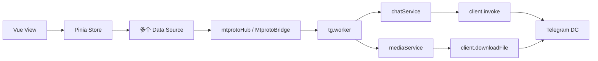
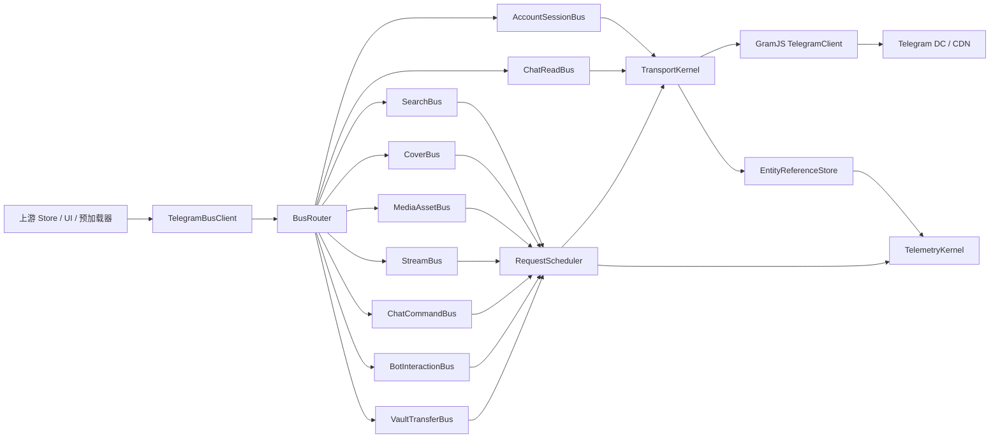
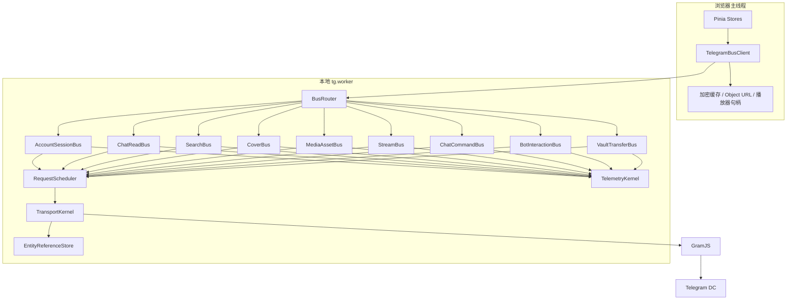
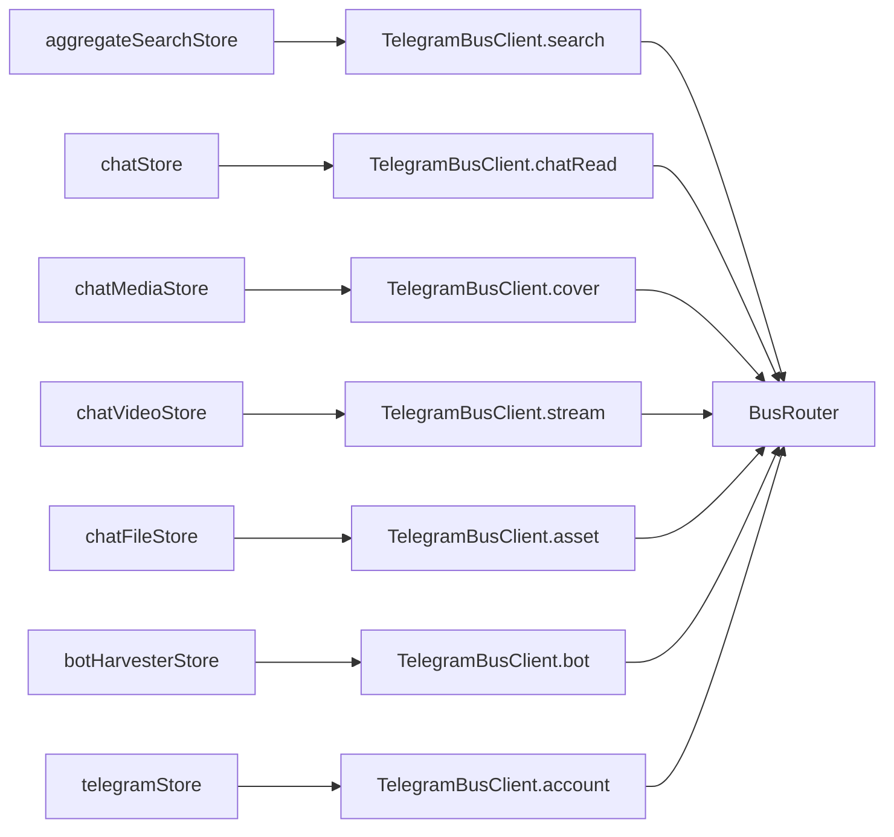
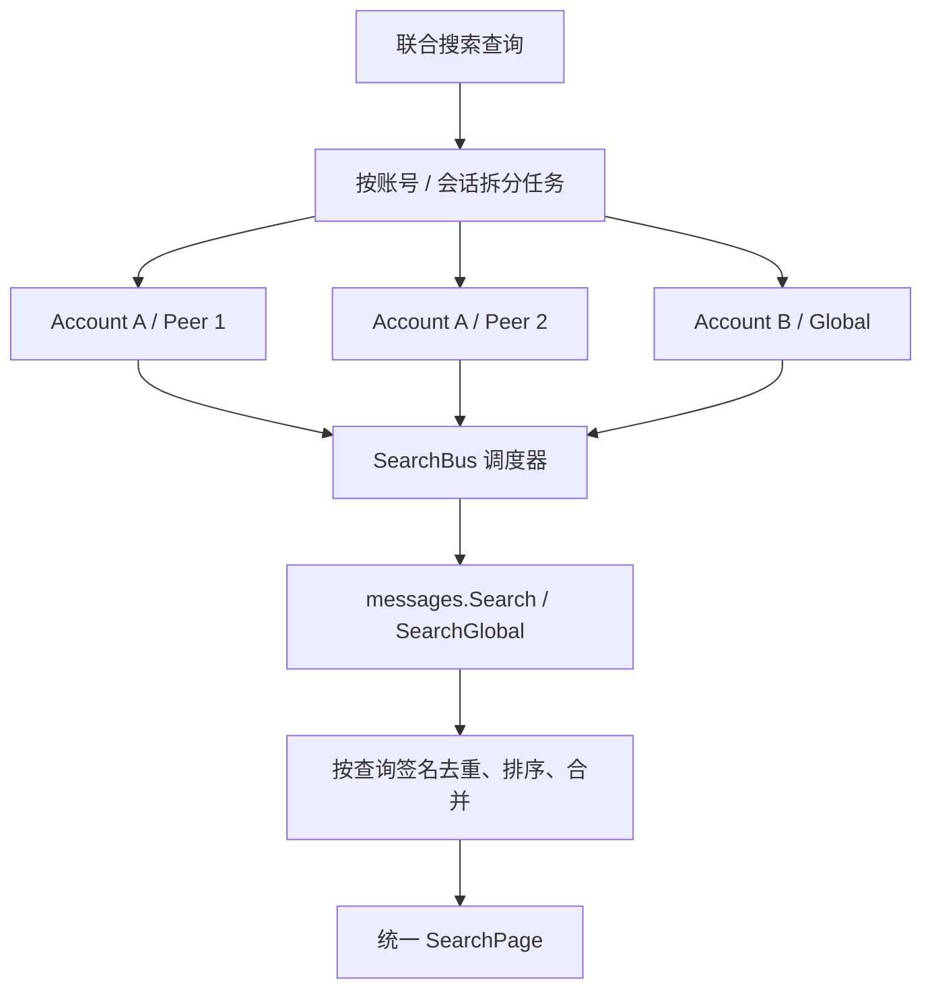
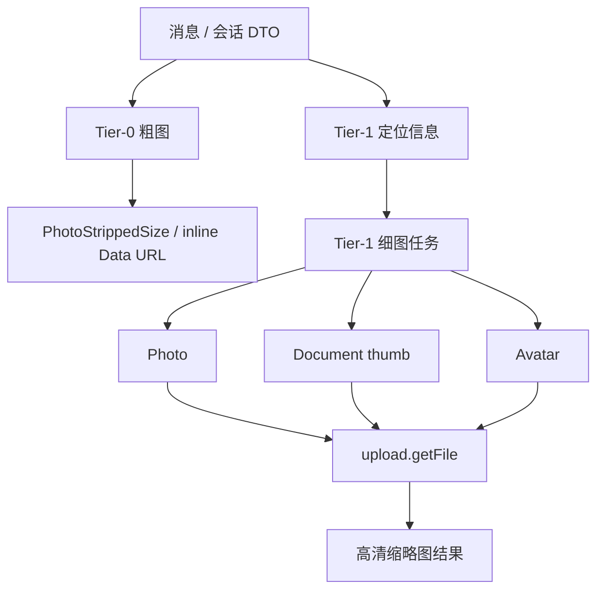
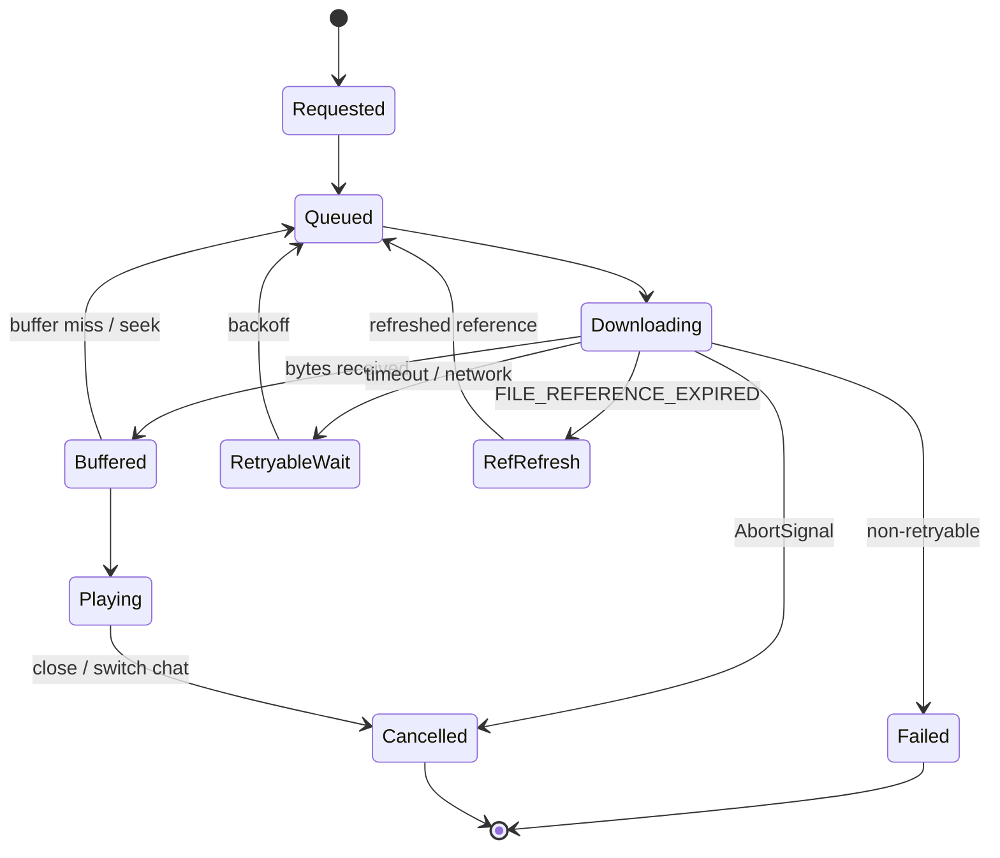
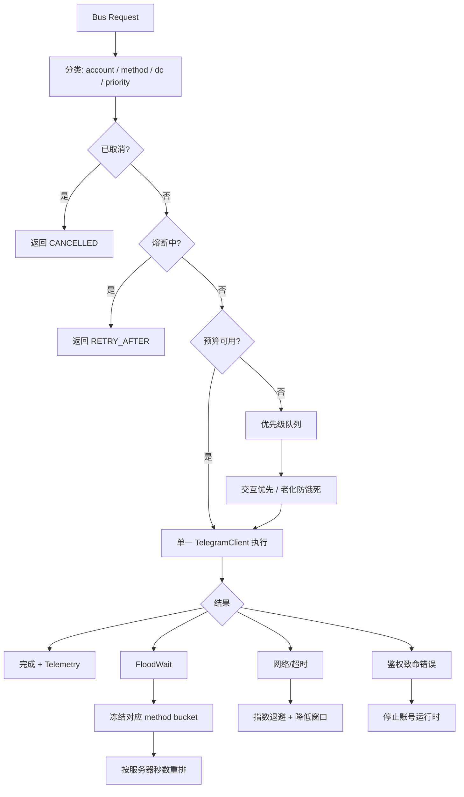

# GramJS 业务总线重构方案

> 状态：设计基线
>
> 范围：Telegram/GramJS 数据面、业务总线、并发调度、媒体/搜索/Chat 统一入口、日志边界
>
> 原则：这是一次彻底重构，不保留旧 Data Source、旧 `TgChatRequest` 分发器和旧的按业务散落 `client.invoke()` 兼容路径。旧路径在新总线切换完成后物理删除。

## 1. 决策摘要

### 1.1 总线数量

拟定 **9 条 GramJS 业务总线**，另设 4 个不属于业务域的共享内核模块。

| 编号 | 业务总线 | 负责内容 | 明确不负责 |
|---|---|---|---|
| B1 | `AccountSessionBus` 账号会话总线 | 登录、二维码、手机号登录、会话恢复、账号切换、DC/连接状态 | Chat 消息和媒体业务 |
| B2 | `ChatReadBus` Chat 读取与同步总线 | Dialog、置顶、历史、上下文、实时更新、PTS、`getDifference` | 搜索、媒体下载、写操作 |
| B3 | `SearchBus` 搜索总线 | 单会话搜索、全局搜索、多账号/多会话联合搜索、Telegram 游标、去重 | 封面实际下载 |
| B4 | `CoverBus` 封面与缩略图总线 | Tier-0 粗图、Tier-1 细图、头像、照片封面、文档缩略图 | 完整文件和视频播放 |
| B5 | `MediaAssetBus` 媒体文件总线 | 完整照片、完整视频、文件、音频、语音、断点下载、取消 | 视频播放调度 |
| B6 | `StreamBus` 流媒体总线 | Range/分片、预读、seek、Service Worker 协作、播放器取消和降级 | 搜索结果封面 |
| B7 | `ChatCommandBus` Chat 命令总线 | 发送、编辑/删除、归档、加入、退出、删除会话、邀请处理 | 机器人流程编排 |
| B8 | `BotInteractionBus` 机器人交互总线 | `/start`、Callback、按钮分页、静默编辑等待、超时和候选收割 | 普通 Chat 写操作 |
| B9 | `VaultTransferBus` 保险库转存总线 | Forward、noforwards 克隆、Forum Topic、Beacon 凭据同步 | 普通媒体展示 |

以下 4 个模块是所有业务总线共享的基础设施，不计入业务总线数量：

```text
TransportKernel       GramJS TelegramClient、DC sender、连接状态
RequestScheduler      优先级、并发预算、队列、取消、FloodWait、熔断
EntityReferenceStore  peer、access_hash、file_reference、消息实体缓存
TelemetryKernel       trace/span、结构化日志、指标、请求结果分类
```

### 1.2 总体原则

1. 上游只能调用业务总线契约，禁止直接拿到 `TelegramClient`。
2. 任何 Telegram RPC、`downloadFile`、`iterDownload`、`client.invoke` 都只能出现在总线实现或共享内核中。
3. 一个 Telegram 账号只允许一个活跃的 `TelegramClient` 运行时实例。
4. 并发通过请求调度器控制，不通过复制同一 StringSession 的多个客户端硬堆。
5. 搜索、封面、媒体和流媒体拥有独立预算，但受账号级总预算约束。
6. 所有业务总线请求都必须拥有 `traceId`、`accountId`、`operation`、`priority` 和 `AbortSignal`。
7. 新架构切换后删除旧的 `chatDataSource`、旧的 `TgChatRequest`、旧的业务直接调用路径，不保留兼容适配层。

## 2. 当前系统到目标系统

### 2.1 当前路径



当前问题不是功能不足，而是 **入口分散**：搜索、封面、Chat、媒体、机器人和保险库都通过不同函数进入 Worker，统一修改并发、重试、日志和优先级时需要同时修改多处。

### 2.2 目标路径



### 2.3 Worker 内部边界



## 3. 总线契约设计

### 3.1 统一请求上下文

```ts
export type TelegramBusPriority =
  | 'interactive'
  | 'visible'
  | 'prefetch'
  | 'background'
  | 'maintenance';

export interface TelegramBusContext {
  requestId: string;
  traceId: string;
  accountId: string;
  priority: TelegramBusPriority;
  signal?: AbortSignal;
  deadlineAt?: number;
  source: string;
}

export interface TelegramBusError {
  code: string;
  bucket:
    | 'AUTH'
    | 'OFFLINE'
    | 'FLOOD_WAIT'
    | 'NETWORK'
    | 'TIMEOUT'
    | 'CANCELLED'
    | 'NO_PEER'
    | 'NO_MEDIA'
    | 'REF_EXPIRED'
    | 'PERMISSION'
    | 'NOT_FOUND'
    | 'UNKNOWN';
  retryable: boolean;
  retryAfterMs?: number;
}
```

业务总线只暴露 DTO 和领域错误，不暴露 GramJS 的 `Api.*` 类型。`Api.*` 只能出现在 local Worker 的总线内部。

### 3.2 总线接口形态

```ts
export interface SearchBus {
  search(
    context: TelegramBusContext,
    query: SearchQuery,
  ): Promise<SearchPage>;
}

export interface CoverBus {
  loadTier0(input: CoverTier0Input): CoverTier0Result;
  loadTier1(
    context: TelegramBusContext,
    input: CoverTier1Input,
  ): Promise<CoverBinaryResult>;
}

export interface StreamBus {
  readPart(
    context: TelegramBusContext,
    input: StreamPartInput,
  ): Promise<StreamPartResult>;
}
```

### 3.3 上游调用规则



上游不再知道：

- 使用哪个 `Api.messages.*` 方法
- 是否需要 `resolveInputPeer`
- 是否需要刷新 `file_reference`
- 是否需要走哪一个 DC
- 是否需要 FloodWait 退避
- 是否需要 `advancePtsFromRpcResult`
- 是否需要记录哪个日志 Span

## 4. 九条业务总线的职责

## B1 `AccountSessionBus`

### 负责

- `connect`
- `disconnect`
- `restore`
- `beginPhoneLogin`
- `beginQrLogin`
- `submitPhone`
- `submitCode`
- `submitPassword`
- 账号健康探针
- 设备授权恢复
- 前台账号切换
- 连接状态事件

### 规则

- 一个 `accountId` 同一时刻只有一个 `TelegramClient`。
- 登录客户端和在线客户端可以在登录阶段临时并存，但登录完成后必须合并到单一运行时。
- 账号切换必须由总线负责取消旧账号队列、清理媒体引用和阻止旧请求回写。

## B2 `ChatReadBus`

### 负责

- Dialog 分页
- 置顶 Dialog
- 活跃/归档文件夹
- 历史消息
- 历史上下文
- `getDifference`
- PTS 连续性
- 实时 Update 转换
- 更新批量广播

### 规则

- `pts` 状态只允许由该总线和 TransportKernel 推进。
- 任何产生 `Updates`、`AffectedHistory`、`AffectedMessages` 或 `UpdateShortSentMessage` 的 RPC 必须经过统一 PTS 处理。
- 不把缓存命中当作 live。
- 旧账号、旧窗口、旧 epoch 的响应必须丢弃。

## B3 `SearchBus`

### 负责

- 单会话 `messages.Search`
- 全局 `messages.SearchGlobal`
- 多会话联合搜索
- 多账号联合搜索
- Telegram offset 游标
- 结果去重
- service message 过滤
- 搜索结果 DTO 化

### 多会话联合搜索模型



联合搜索不能简单地 `Promise.all` 无限并发。每个账号有独立搜索配额，但仍受账号级总预算、FloodWait 和网络状态约束。

## B4 `CoverBus`

### 两级模型



### 负责

- 粗图提取和验证
- 头像加载
- 图片预览档位选择
- 视频 Photo 封面
- 视频 Document thumb
- 普通文件 thumb
- `file_reference` 刷新后的重试
- 搜索封面和 Chat 封面统一调度

### 不负责

- 完整媒体文件
- 视频流
- 原始 Message DTO 构造

### 初始调度预算

| 维度 | 初始值 | 说明 |
|---|---:|---|
| 账号级封面并发 | 6 | 动态可降级，不是 Telegram 保证值 |
| 头像并发 | 2 | 头像优先但限制数量 |
| 搜索封面保底槽位 | 2 | 避免被 Chat 媒体饿死 |
| 单次请求超时 | 30s idle | 有持续进度则不判死 |
| Tier-0 | 不占 RPC 槽 | DTO 内联数据直接使用 |

## B5 `MediaAssetBus`

### 负责

- 完整照片下载
- 完整视频文件下载
- 文件、音频、语音下载
- 进度汇报
- 取消
- 文件引用刷新
- `FILE_MIGRATE` 处理
- 加密缓存写入

### 规则

- 完整文件不能抢占交互式 Chat、搜索或头像的全部资源。
- 只有用户主动打开或下载时，才提升为 interactive/visible 优先级。
- 后台下载必须有明确的全局预算和用户可取消入口。

## B6 `StreamBus`

### 负责

- `upload.getFile` 分片读取
- 512 KiB 对齐
- Range 请求合并
- 播放头部优先
- seek 目标优先
- 前后缓冲区预读
- Service Worker Range 协议
- 播放器取消
- 不支持流式时降级完整下载

### 分片状态机



## B7 `ChatCommandBus`

### 负责

- 发送文本
- 回复消息
- 编辑消息
- 删除消息
- 归档/取消归档
- 加入公开会话
- 退出会话
- 删除私聊
- 检查邀请
- 导入邀请
- `resolveUsername`

### 规则

- 所有写操作都必须明确标记为 `interactive`。
- 写操作不能由后台预加载触发。
- 成功后由返回的 Updates 推进本地状态，不允许只改前端数组伪造成功。
- 慢速模式、FloodWait 和权限错误直接转领域错误。

## B8 `BotInteractionBus`

### 负责

- `/start`
- `messages.StartBot`
- `messages.GetBotCallbackAnswer`
- Inline Keyboard
- Callback loading 状态
- Callback 超时
- UpdateEditMessage 结束等待
- Bot Harvester 翻页和候选收割

### 规则

`BOT_RESPONSE_TIMEOUT` 是业务超时，不得进入连接重连判断。收到目标消息的 `UpdateEditMessage` 后必须清除该消息所有 pending callback。

## B9 `VaultTransferBus`

### 负责

- `messages.ForwardMessages`
- noforwards 媒体中继
- 保险库群创建/检查
- Forum Topic 管理
- Beacon 凭据同步
- 转存结果和失败恢复

### 规则

- 转存请求是后台高成本任务，不能占满交互队列。
- noforwards 克隆使用独立的文件流预算。
- 不把 Telegram 内容上传到 Lattice Remote/D1。

## 5. 连接与并发调查结论

## 5.1 没有可依赖的固定“总连接数上限”

调查没有发现 Telegram 官方公布一个可以直接套用的数字，例如：

```text
每账号最多 N 条 MTProto 连接
每 API ID 最多 N 个连接
每 IP 最多 N 个连接
每 DC 最多 N 个连接
```

Telegram 官方 MTProto 文档明确描述：同一个服务器可以存在多个连接，消息可以通过任意连接传输；但响应不会跨越不同 MTProto session 返回。官方文档没有把它定义成应用层连接池的吞吐承诺。

结论：

> “允许多连接存在”不等于“可以无限复制连接获得线性吞吐”。

## 5.2 同一 StringSession 不应被多个独立客户端并行持有

GramJS 社区 issue #191 的维护者给出的结论是：

- 同一个 session string 可以在同一 IP 使用
- 如果需要接收更新，应使用不同的 session string
- Telegram 会把更新发送给最新运行的客户端/会话

这不是一个适合依赖的高吞吐方案。对于本项目尤其危险，因为 Chat 需要稳定接收 Update、维护 PTS 和保持实体缓存一致。

方案决策：

```text
同一 Telegram 账号：一个 TelegramClient 运行时
同一 Telegram 账号：不复制 StringSession 创建多个主客户端
多个业务请求：在同一客户端上由 RequestScheduler 做受控并发
多个 Telegram 账号：每账号一个运行时，由 AccountSessionBus 管理
```

## 5.3 GramJS 提供的是客户端参数，不是服务端限额

GramJS 文档提供了这些参数：

- `connectionRetries`
- `requestRetries`
- `downloadRetries`
- `retryDelay`
- `autoReconnect`
- `floodSleepThreshold`
- `maxConcurrentDownloads`
- `sequentialUpdates`

其中：

- `floodSleepThreshold` 只决定小于阈值的 FloodWait 是否自动 sleep，默认值为 60 秒。
- 大于阈值的 FloodWait 会抛给上层处理。
- `maxConcurrentDownloads` 是下载并发控制，不是 Telegram 服务端的全局额度。
- `requestRetries` 主要覆盖内部错误、RPC call fail、阈值内 FloodWait 和 migrate 类错误。

因此不能把 `maxConcurrentDownloads` 或 `requestRetries` 当作“允许安全并发数”。

## 5.4 Telegram 的真实约束是方法、账号、行为和状态组合

官方错误文档明确包含：

```text
FLOOD_WAIT_X
SLOWMODE_WAIT_X
FLOOD_PREMIUM_WAIT_X
AUTH_KEY_DUPLICATED
```

官方 API 申请页面明确警告：

- API client libraries 会受到监控
- flooding、spamming、伪造订阅/浏览量会导致永久封禁
- 非官方客户端登录的账号会被置于观察状态
- 官方示例 API ID 不能用于面向用户的生产发布

所以限流判断不能只看连接数，还必须看：

```text
账号
API ID
源 IP
DC
RPC 方法
请求参数重复度
消息/邀请行为
时间窗口
是否持续接收更新
```

## 5.5 媒体下载可以并发，但必须单独限流

官方 `upload.getFile` 支持按 offset/limit 获取文件部分，并明确存在：

- `FILE_REFERENCE_EXPIRED`
- `FILE_REFERENCE_INVALID`
- `LIMIT_INVALID`
- `OFFSET_INVALID`
- `CDN_METHOD_INVALID`

GramJS 暴露 `maxConcurrentDownloads`，社区也存在通过多个 worker/并发下载提升速度的实践，但这属于经验参数，不是官方安全上限。

媒体并发的主要瓶颈通常是：

```text
DC 到客户端的吞吐
浏览器 Worker 内存
ArrayBuffer / Blob 拷贝
Service Worker 缓冲
Telegram FloodWait
file_reference 刷新
单个 DC sender 的排队
```

## 5.6 对本项目的并发决策

第一阶段不采用多主连接池，采用：

```text
每账号一个 TelegramClient
每业务域独立队列
账号级总并发预算
业务级子预算
优先级抢占
FloodWait 自适应降速
熔断和恢复
```

建议初始预算，仅作为压测起点，不能视为 Telegram 官方保证：

| 资源 | 初始预算 | 备注 |
|---|---:|---|
| 账号级非媒体 RPC 并发 | 4 | 读取/搜索/命令共享总池 |
| 账号级媒体 RPC 并发 | 4 | 与非媒体池隔离 |
| 账号级总活跃任务 | 8 | 达到后排队，不新建连接 |
| Chat 交互读取 | 2 | 首屏和当前会话优先 |
| Search | 2 | 全局搜索默认不超过 2 |
| Cover | 4 | 可被 visible 请求抢占 |
| Avatar | 2 | 小请求独立保底 |
| Full media | 2 | 完整文件低于封面/交互优先级 |
| Stream parts | 3 | 单视频预读/seek 共用 |
| Vault transfer | 1 | 后台低优先级 |
| Bot callback | 1 | 保证顺序和状态机稳定 |

动态规则：

```text
连续成功窗口扩大预算，最大不超过配置上限
出现 FloodWait：立即冻结对应 method bucket
出现网络超时：降低该 DC 的并发窗口
出现 AUTH_KEY_DUPLICATED：停止该账号全部队列
出现 FILE_REFERENCE_EXPIRED：只刷新引用，不重启连接
出现 BOT_RESPONSE_TIMEOUT：只结束业务等待，不重连
```

## 6. RequestScheduler 设计

### 6.1 调度器结构



### 6.2 调度键

每个请求至少按以下维度调度：

```text
accountId
operationFamily
methodName
dcId
priority
```

例如：

```text
account-1 / search / messages.SearchGlobal / main-dc / visible
account-1 / cover / upload.getFile / dc-4 / visible
account-1 / stream / upload.getFile / dc-4 / interactive
account-1 / bot / messages.GetBotCallbackAnswer / main-dc / interactive
```

### 6.3 不允许的做法

```text
Promise.all(1000 个 client.invoke)
同一 StringSession 创建多个 TelegramClient
每个搜索结果单独创建连接
每个封面单独创建连接
遇到 FloodWait 就新建客户端绕过
把所有媒体和搜索请求放进一个无优先级队列
由 Store 自己实现重试和延迟
```

## 7. 彻底重构目录

目标目录建议：

```text
src/worker/local/telegram/
├── runtime/
│   ├── telegramRuntime.ts
│   ├── transportKernel.ts
│   ├── requestScheduler.ts
│   ├── entityReferenceStore.ts
│   └── telegramErrorPolicy.ts
├── buses/
│   ├── accountSessionBus.ts
│   ├── chatReadBus.ts
│   ├── searchBus.ts
│   ├── coverBus.ts
│   ├── mediaAssetBus.ts
│   ├── streamBus.ts
│   ├── chatCommandBus.ts
│   ├── botInteractionBus.ts
│   └── vaultTransferBus.ts
├── contracts/
│   ├── busContext.ts
│   ├── accountContracts.ts
│   ├── chatContracts.ts
│   ├── searchContracts.ts
│   ├── coverContracts.ts
│   ├── mediaContracts.ts
│   ├── streamContracts.ts
│   ├── commandContracts.ts
│   ├── botContracts.ts
│   └── vaultContracts.ts
├── converters/
│   ├── peerConverter.ts
│   ├── messageConverter.ts
│   ├── mediaConverter.ts
│   └── dialogConverter.ts
├── telemetry/
│   ├── telegramTelemetry.ts
│   ├── spanContext.ts
│   └── metrics.ts
└── telegramWorker.ts
```

主线程只保留一个薄客户端：

```text
src/stores/telegram/data-sources/telegramBusClient.ts
```

Chat、Search、Cover、Media、Stream、Bot 等 Store 不再各自直接调用 `mtprotoHub.bridge().requestChat()`，而是调用统一客户端：

```ts
telegramBusClient.search.search(context, query)
telegramBusClient.cover.loadTier1(context, input)
telegramBusClient.stream.readPart(context, input)
telegramBusClient.chatRead.getHistory(context, input)
telegramBusClient.command.sendMessage(context, input)
```

## 8. 彻底删除的旧结构

重构完成后必须删除，不做兼容转发：

```text
src/stores/chat/data-sources/chatDataSource.ts
src/worker/local/chat/chatService.ts
src/worker/local/chat/mediaService.ts
src/worker/local/chatProtocol.ts 中旧 TgChatRequest 分发契约
旧的 requestChat(accountId, request) 入口
旧的按方法字符串 if-chain dispatcher
各业务直接使用 mtprotoHub.bridge().requestChat 的路径
业务层直接依赖 Api.* 类型的路径
```

需要保留或迁移的能力：

```text
PTS 状态机
消息/媒体/Peer converter
Telegram error classifier
缓存与播放器 DOM 句柄
MTProto bridge 的跨标签页能力
```

但这些能力必须重新挂到新总线契约下，而不是通过旧文件继续转发。

## 9. 重构阶段

### Phase 0：冻结协议和基准

产出：

- 九条总线契约
- 错误分桶表
- 优先级表
- 请求指标表
- 当前请求方法清单
- 当前日志动作清单

不允许在此阶段继续向旧 `TgChatRequest` 增加方法。

### Phase 1：建立 Runtime Kernel

实现：

- `TelegramRuntime`
- 单账号单客户端生命周期
- `RequestScheduler`
- FloodWait policy
- 统一取消
- 统一 Trace
- EntityReferenceStore

验收：

- 所有 GramJS 调用都能被调度器捕获
- 账号切换能够取消旧账号任务
- AUTH_KEY_DUPLICATED 能停止账号运行时

### Phase 2：迁移读取和搜索

顺序：

1. `AccountSessionBus`
2. `ChatReadBus`
3. `SearchBus`

原因：搜索依赖 Peer、Dialog 和账号状态；先建立读取总线能减少后续转换。

### Phase 3：迁移封面、媒体和流媒体

顺序：

1. `CoverBus`
2. `MediaAssetBus`
3. `StreamBus`

封面和完整媒体必须共享 `EntityReferenceStore`，但使用不同预算。

### Phase 4：迁移命令、机器人和保险库

顺序：

1. `ChatCommandBus`
2. `BotInteractionBus`
3. `VaultTransferBus`

写操作必须在该阶段重新确认：

- PTS 推进
- Update 回放
- 成功后状态更新
- FloodWait
- 权限错误
- 幂等性

### Phase 5：物理删除旧路径

执行：

- 删除旧接口
- 删除旧方法字符串协议
- 删除旧 Data Source 转发器
- 删除旧 dispatcher
- 删除所有直接 `client.invoke` 的业务调用
- 用静态搜索确认只有总线/TransportKernel 可以触达 GramJS

## 10. 日志和指标重构

### 10.1 每个总线统一日志

每次请求至少产出：

```text
bus.request.start
bus.request.queued
bus.request.invoke
bus.request.ok
bus.request.error
bus.request.cancelled
bus.request.retry
bus.request.flood_wait
bus.request.circuit_open
```

字段：

```text
traceId
spanId
accountId
bus
operation
method
priority
dcId
queueMs
invokeMs
durMs
attempt
concurrencyAtStart
bucket
retryAfterMs
```

### 10.2 专项日志

```text
chat.pts
chat.updates
search.page
cover.tier0
cover.tier1
media.download
stream.part
bot.callback
vault.transfer
account.session
```

### 10.3 关键指标

| 指标 | 用途 |
|---|---|
| queue_wait_ms | 判断是不是客户端排队造成慢 |
| rpc_duration_ms | 判断 Telegram/DC 响应速度 |
| active_requests | 判断预算是否过小或过大 |
| flood_wait_count | 观察限流 |
| flood_wait_seconds | 观察限流强度 |
| retry_count | 观察网络/业务重试 |
| cover_tier0_ratio | 粗图命中率 |
| cover_tier1_success_ratio | 细图成功率 |
| media_throughput_bytes_per_sec | 下载吞吐 |
| stream_buffer_miss | 播放卡顿风险 |
| pts_gap_count | 更新连续性问题 |
| auth_key_duplicated_count | 多客户端/会话破坏 |
```

## 11. 方案验收标准

### 架构验收

- [ ] 所有 GramJS 调用只存在于 `runtime/` 和 `buses/`
- [ ] Store 不引用 `Api.*`
- [ ] Store 不构造 Telegram 原始请求
- [ ] 没有旧 `TgChatRequest` 字符串分发器
- [ ] 同一账号运行时只有一个 `TelegramClient`
- [ ] 所有请求都有统一上下文和取消能力

### 并发验收

- [ ] 搜索、封面、媒体、流媒体有独立预算
- [ ] 账号级总预算生效
- [ ] FloodWait 只冻结对应方法/账号桶，不盲目重连
- [ ] 交互请求能抢占后台预取
- [ ] 1000 个上游任务不会创建 1000 条连接
- [ ] 取消请求后不会继续写入过期 Store/缓存

### 数据正确性验收

- [ ] PTS 只由 ChatReadBus/RuntimeKernel 推进
- [ ] `UpdateShortSentMessage` 等结果不会漏推进 pts
- [ ] file_reference 过期只刷新引用并重试一次
- [ ] 账户切换后旧结果全部丢弃
- [ ] BOT_RESPONSE_TIMEOUT 不触发重连
- [ ] noforwards 转存不绕过 VaultTransferBus

## 12. 研究依据与可信度

### 官方资料

1. GramJS TelegramClient 参数文档：
   <https://gram.js.org/beta/interfaces/client.telegramBaseClient.TelegramClientParams.html>
   
   确认了 `floodSleepThreshold`、`connectionRetries`、`requestRetries`、`maxConcurrentDownloads` 等客户端参数。未给出一个“单账号安全连接数”的固定值。

2. GramJS TelegramClient 文档：
   <https://gram.js.org/beta/classes/TelegramClient.html>
   
   确认 `invoke`、`downloadFile`、`iterDownload` 和 `maxConcurrentDownloads` 的客户端能力。

3. Telegram MTProto 官方协议：
   <https://core.telegram.org/mtproto>
   
   明确说明一个服务器可以存在多个连接，消息可以在多个连接上传输，但响应不会跨不同 session 返回。

4. Telegram API 错误处理：
   <https://core.telegram.org/api/errors>
   
   确认 `FLOOD_WAIT_X`、`SLOWMODE_WAIT_X`、`FLOOD_PREMIUM_WAIT_X`、`AUTH_KEY_DUPLICATED` 等错误语义。

5. Telegram API ID 申请和滥用约束：
   <https://core.telegram.org/api/obtaining_api_id>
   
   确认 API client 会受到监控，滥用、刷量、spam/flood 可能导致封禁，公开示例 API ID 不适合生产发布。

6. Telegram `upload.getFile`：
   <https://core.telegram.org/method/upload.getFile>
   
   确认按 offset/limit 获取文件分片，以及 file reference、limit、offset、CDN 等错误。

### GramJS 社区资料

1. GramJS issue #191：
   <https://github.com/gram-js/gramjs/issues/191>
   
   维护者讨论了同一 session、多连接和 Update 接收问题。该内容是社区维护者意见，不是 Telegram 正式限额表，但足以支持“不要为同一账号复制多个主客户端”的工程决策。

2. GramJS issue #303：
   <https://github.com/gram-js/gramjs/issues/303>
   
   讨论了 FloodWait、连接重试、多个并行连接和断线错误。该 issue 也显示，连接数量增加并不等于稳定吞吐，可能转化为 timeout、reconnect 或内存问题。

3. GramJS issue #647：
   <https://github.com/gram-js/gramjs/issues/647>
   
   社区讨论了多文件下载与吞吐问题，说明下载速度需要通过任务级并发和分片策略优化，而不是简单复制客户端连接。

4. GramJS issue #326：
   <https://github.com/gram-js/gramjs/issues/326>
   
   讨论下载文件分段/Range 能力，支持将流媒体设计为受控分片读取，而不是对每个播放请求重新创建连接。

### 研究结论的边界

- Telegram 没有公开一个可以用于本项目容量规划的“每账号连接数上限”数字。
- 社区中出现的 `2-10`、`4 workers/DC` 等数字属于具体客户端、具体环境或经验配置，不能直接当成 Telegram 全局规则。
- 本方案的并发预算是压测起点，必须在真实账号、真实 DC、真实网络下通过指标调整。
- 任何绕过 FloodWait、复制 session、使用多 API ID 规避限制的方案都不纳入设计。

## 13. 最终建议

采用：

```text
9 条业务总线
+ 4 个共享内核
+ 每账号一个 TelegramClient
+ 单客户端受控并发
+ 业务独立队列
+ 账号级总预算
+ FloodWait 自适应退避
+ 全量统一 Telemetry
+ 彻底删除旧请求分发体系
```

不采用：

```text
同一账号多 TelegramClient 连接池
无上限 Promise.all
每业务域自己实现重试
每个封面/分片创建连接
通过更换 API ID 或 session 绕过限流
兼容旧 TgChatRequest 的长期适配层
```

这个方案可以同时满足两个目标：

1. 通过业务总线把同类 GramJS 交互统一治理，后续修改并发、重试、日志和缓存策略时只改一个域。
2. 在没有公开固定连接上限的情况下，用可调度的请求并发替代不可控的连接数量扩张，保留后续压测和自适应优化空间。
