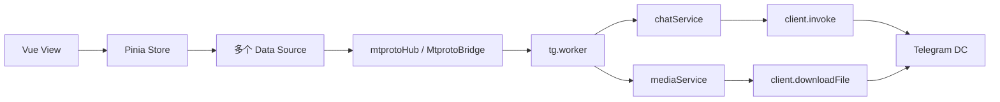
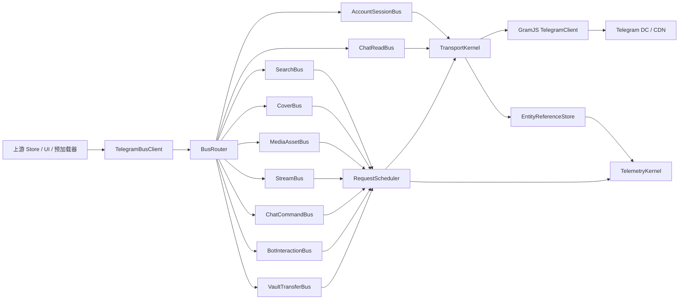
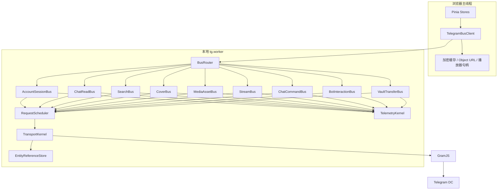
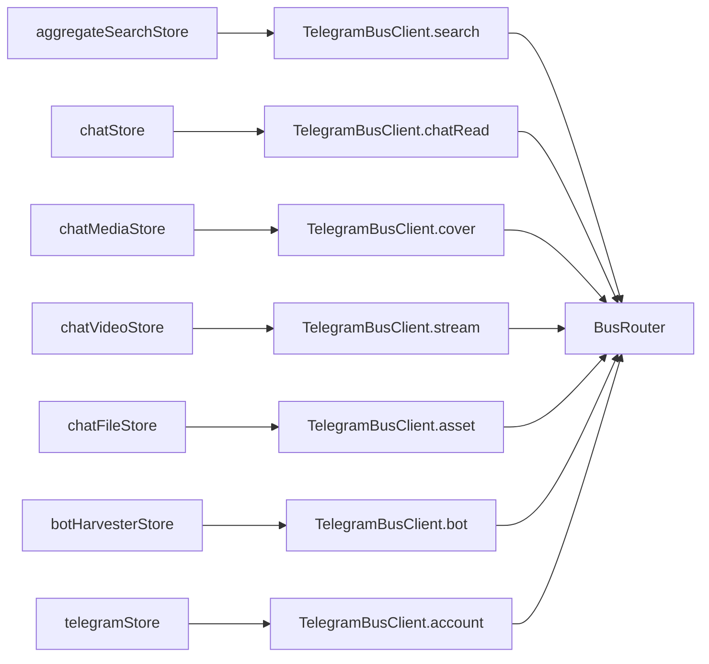
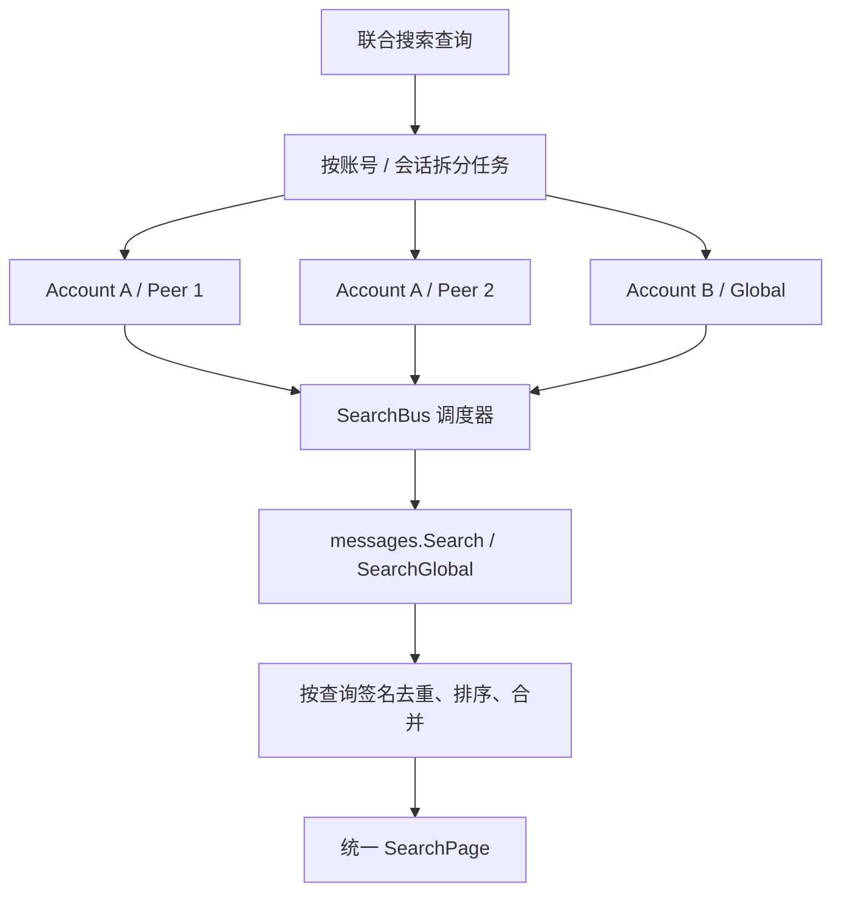
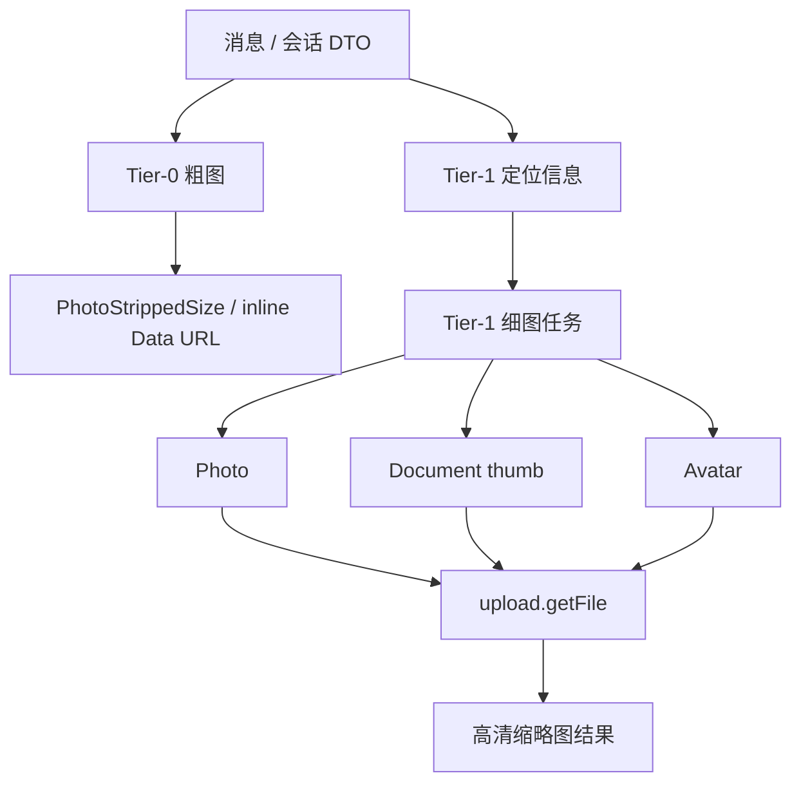
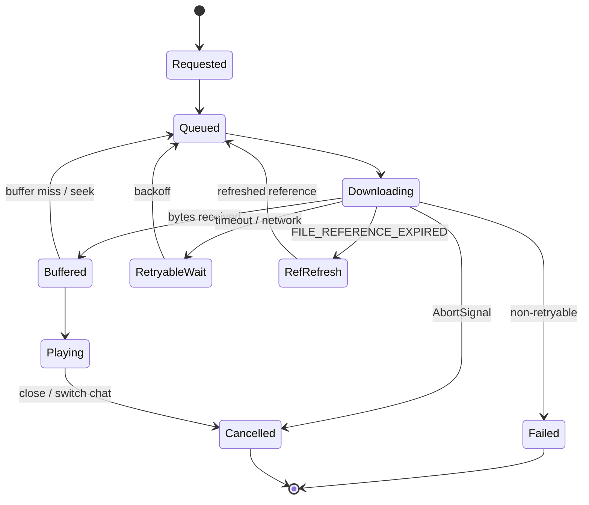
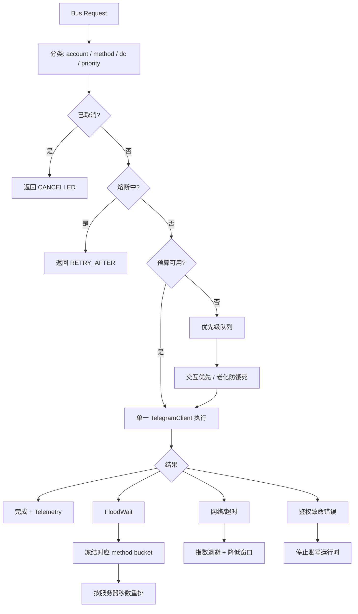
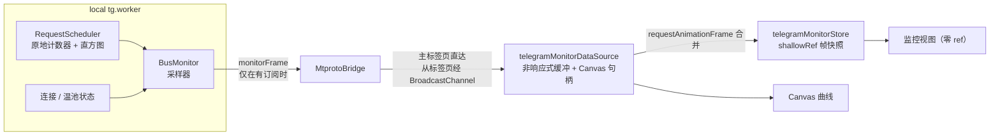

# GramJS 业务总线重构方案

> 强制规则以 [`.rules/telegram-bus-and-concurrency.md`](../../.rules/telegram-bus-and-concurrency.md) 为准；本文保留设计背景与实施记录。

> 状态：设计基线
>
> 范围：Telegram/GramJS 数据面、业务总线、并发调度、媒体/搜索/Chat 统一入口、日志边界
>
> 原则：这是一次彻底重构，不保留旧 Data Source、旧 `TgChatRequest` 分发器和旧的按业务散落 `client.invoke()` 兼容路径。旧路径在新总线切换完成后物理删除。

## 1. 决策摘要

### 1.1 总线数量

拟定 **9 条 GramJS 业务总线**，另设 4 个不属于业务域的共享内核模块。

| 编号 | 业务总线 | 负责内容 | 明确不负责 |
|---|---|---|---|
| B1 | `AccountSessionBus` 账号会话总线 | 登录、二维码、手机号登录、会话恢复、账号切换、DC/连接状态 | Chat 消息和媒体业务 |
| B2 | `ChatReadBus` Chat 读取与同步总线 | Dialog、置顶、历史、上下文、实时更新、PTS、`getDifference` | 搜索、媒体下载、写操作 |
| B3 | `SearchBus` 搜索总线 | 单会话搜索、全局搜索、多账号/多会话联合搜索、Telegram 游标、去重 | 封面实际下载 |
| B4 | `CoverBus` 封面与缩略图总线 | Tier-0 粗图、Tier-1 细图、头像、照片封面、文档缩略图 | 完整文件和视频播放 |
| B5 | `MediaAssetBus` 媒体文件总线 | 完整照片、完整视频、文件、音频、语音、断点下载、取消 | 视频播放调度 |
| B6 | `StreamBus` 流媒体总线 | Range/分片、预读、seek、Service Worker 协作、播放器取消和降级 | 搜索结果封面 |
| B7 | `ChatCommandBus` Chat 命令总线 | 发送、编辑/删除、归档、加入、退出、删除会话、邀请处理 | 机器人流程编排 |
| B8 | `BotInteractionBus` 机器人交互总线 | `/start`、Callback、按钮分页、静默编辑等待、超时和候选收割 | 普通 Chat 写操作 |
| B9 | `VaultTransferBus` 保险库转存总线 | Forward、noforwards 克隆、Forum Topic、Beacon 凭据同步 | 普通媒体展示 |

以下 4 个模块是所有业务总线共享的基础设施，不计入业务总线数量：

```text
TransportKernel       GramJS TelegramClient、DC sender、连接状态
RequestScheduler      优先级、并发预算、队列、取消、FloodWait、熔断
EntityReferenceStore  peer、access_hash、file_reference、消息实体缓存
TelemetryKernel       trace/span、结构化日志、指标、请求结果分类
```

### 1.2 并发配额配置原则

并发配额暂不视为 Telegram 的固定安全上限，而是采用：

```text
内置预设值 + 设置页统一配置 + 本地运行时保护上限 + 动态调度降速
```

所有并发数字必须集中定义，业务总线不得各自硬编码。用户配置值与调度器当前实际生效值必须分离：

- **用户配置值**：用户在“设置 → 性能与网络 → Telegram 并发与下载”中选择的模式或自定义上限。
- **运行时有效值**：`RequestScheduler` 根据 FloodWait、网络超时、设备状态和账号状态临时调整后的值；不得永久突破用户配置上限。

建议提供四种模式：`stable`（稳定）、`balanced`（默认）、`aggressive`（高吞吐）、`custom`（安全范围内自定义）。首轮压测预设如下，它们是工程起点，不代表 Telegram 官方额度：

| 资源 | stable | balanced（默认） | aggressive |
|---|---:|---:|---:|
| 账号级非媒体 RPC | 3 | 6 | 10 |
| 账号级媒体 RPC | 6 | 12 | 20 |
| 账号级总活跃任务 | 9 | 18 | 30 |
| 搜索 RPC | 2 | 3 | 5 |
| 封面 | 4 | 8 | 14 |
| 搜索封面保底槽位 | 2 | 3 | 6 |
| 头像 | 2 | 3 | 5 |
| 完整媒体（文件数） | 1 | 3 | 5 |
| 文件分片 | 2 | 4 | 8 |
| 流媒体分片 | 2 | 4 | 6 |

预设约束：组预算必须不小于其任一子池（媒体组 ≥ 封面 + 头像，保证封面跑满时头像仍有余量），总预算 = 媒体组 + 非媒体组。早期草案中“封面 8 / 媒体 RPC 6”的组合会让封面永远达不到配置值，已在实现时修正，并由归一化函数强制：子池自动夹到所属组预算以内。

暂缓项：`搜索预取`、`流媒体预读分片`、`下载分片大小` 三项暂不开放。当前搜索没有独立预取通道；流媒体预读由浏览器 Range 请求驱动；分片大小受 Service Worker 与 `upload.getFile` 的 512 KiB 对齐协议约束，改动需同步调整 `progressiveStream`。三者在对应总线迁移时再纳入配置。

搜索 RPC 并发与搜索结果封面并发必须明确区分。封面池可服务 Chat、搜索和头像，但必须保留搜索封面保底槽位；所有子池仍受账号级总预算和媒体 RPC 总预算约束。大量上游任务只能进入有界优先级队列，不得通过 `Promise.all` 无限发起 RPC。

自定义配置必须经过本地保护范围校验（范围定义见 `src/worker/local/telegram/contracts/concurrency.ts` 的 `TELEGRAM_CONCURRENCY_BOUNDS`，例如搜索 1–12、封面 1–32、完整文件 1–12、流分片 1–12）。其余内部参数可先由模式统一控制，再在高级设置中开放。用户配置变更影响后续任务；在途请求通过 `AbortSignal`、代次和队列规则自然收敛。

连续成功窗口可逐步恢复至用户配置上限；出现 FloodWait 立即冻结对应 method bucket；出现网络超时降低对应 DC/业务窗口；出现 `AUTH_KEY_DUPLICATED` 停止该账号运行时。调度器可以临时降速，但不得把临时有效值写回用户配置。

### 1.3 总体原则

1. 上游只能调用业务总线契约，禁止直接拿到 `TelegramClient`。
2. 任何 Telegram RPC、`downloadFile`、`iterDownload`、`client.invoke` 都只能出现在总线实现或共享内核中。
3. 一个 Telegram 账号只允许一个活跃的 `TelegramClient` 运行时实例。
4. 并发通过请求调度器控制，不通过复制同一 StringSession 的多个客户端硬堆。
5. 搜索、封面、媒体和流媒体拥有独立预算，但受账号级总预算约束。
6. 所有业务总线请求都必须拥有 `traceId`、`accountId`、`operation`、`priority` 和 `AbortSignal`。
7. 新架构切换后删除旧的 `chatDataSource`、旧的 `TgChatRequest`、旧的业务直接调用路径，不保留兼容适配层。

### 1.4 实施进度

**已完成（第一批：并发配置 + 调度内核 + 架构门禁）**

| 内容 | 位置 |
|---|---|
| 并发契约：预设、保护范围、归一化（Worker 与主线程共用） | `src/worker/local/telegram/contracts/concurrency.ts` |
| 账号级 `RequestScheduler`：三层预算、搜索封面保留槽位、优先级、排队取消、FloodWait 熔断、超时降速与逐步恢复 | `src/worker/local/telegram/runtime/requestScheduler.ts` |
| 媒体下载改走调度器，删除旧 `mediaService` 硬编码并发池；完整文件分片并行度取配置值 | `src/worker/local/telegram/buses/mediaAssetBus.ts`、`streamBus.ts`、`fileTransfer.ts` |
| 搜索 RPC 走 `search` 子池；账号断开 / 温池淘汰时关闭对应调度器 | `telegramRuntime.ts`、`busRouter.ts` |
| 配置下发：`init.concurrency` 与 `setConcurrency` 命令 | `src/worker/local/protocol.ts`、`mtprotoBridge.ts` |
| 搜索结果封面标记 `origin: 'search'`，可使用保留槽位 | `chatProtocol.ts`、`telegramBusClient.ts`、`aggregateSearchDataSource.ts` |
| 主线程限流器（封面总线、媒体加载器）读取同一配置，不再硬编码 | `coverImageBus.ts`、`chatMediaLoader.ts` |
| 设置页“性能与网络”：模式切换、自定义校验、恢复默认 | `telegramPerformanceStore.ts`、`PerformanceSettingsView.vue` |
| 架构门禁（纳入 `pnpm build`）与调度器 / 会话解析行为测试 | `scripts/check-architecture.mjs`、`scripts/test-request-scheduler.mjs`、`scripts/test-session-batch-parser.mjs` |

**架构门禁的选择**：TypeScript 只保证类型，无法阻止“Store 直接触达 GramJS”“视图声明 ref”“硬编码并发”等违规；ESLint 需引入新依赖与 Vue 解析配置。第一阶段采用零依赖脚本 `pnpm arch:check`，在 `pnpm build` 最前执行，与 `vue-tsc` / `tsc` 互补。规则包括 GramJS 引用边界、RPC 调用边界、视图零 ref、视图禁网络、主线程引用 Worker 的允许列表、禁止硬编码并发、禁止新增 `requestChat` 路径、禁止 `src/services/`。既有违规列入遗留豁免，豁免只减不增：违规消失而豁免未删时脚本同样失败。

**已完成（第二批：运行监控面板 M1–M4，见第 14 章）**

| 内容 | 位置 |
|---|---|
| 开发者选项改为左侧二级列表 + 嵌套路由；日志内容迁入“日志”页；监控页仅开发者模式可见 | `DeveloperSettingsView.vue`、`developer/nav/`、`developer/logs/`、`src/router/index.ts` |
| 监控契约（帧、任务、事件、子池 → 总线映射） | `src/worker/local/telegram/contracts/monitor.ts` |
| 调度器埋点：任务记录、累计计数与字节、耗时直方图、事件环、任务句柄 | `requestScheduler.ts`、`mediaService.ts` |
| Worker 采样器：订阅租约、按帧率组帧、任务增量（单帧最多 60 个变化）、10 秒窗口分位数 | `src/worker/local/telegram/telemetry/busMonitor.ts` |
| Bridge 订阅命令与按订阅者路由帧 | `protocol.ts`、`mtprotoBridge.ts` |
| 主线程缓冲、rAF 合并提交、Canvas 曲线、页面隐藏自动退订 | `telegramMonitorDataSource.ts` |
| 监控 Store、虚拟任务表、事件流、跳转日志、导出到云端快照 | `telegramMonitorStore.ts`、`developer/telegram-monitor/*`、`debugLoggerStore.ts` |
| 监控曲线语义色令牌 | `src/style.css`、`.rules/design-system-and-tokens.md` |

**已完成（第三批：Phase 0–5 总线重构与旧路径删除）**

| 内容 | 位置 |
|---|---|
| 统一 9 条总线契约、请求上下文、领域错误与路由表 | `src/worker/local/telegram/contracts/buses.ts`、`busContext.ts`、`runtime/busRouter.ts` |
| 单账号运行时、TransportKernel、PTS 推进、实体引用与文件传输内核 | `runtime/telegramRuntime.ts`、`transportKernel.ts`、`entityReferenceStore.ts`、`fileTransfer.ts` |
| 9 条总线实现并全部接入 RequestScheduler | `telegram/buses/accountSessionBus.ts`、`chatReadBus.ts`、`searchBus.ts`、`coverBus.ts`、`mediaAssetBus.ts`、`streamBus.ts`、`chatCommandBus.ts`、`botInteractionBus.ts`、`vaultTransferBus.ts` |
| 主线程调用统一迁移至 `TelegramBusClient`，删除旧 `chatDataSource` / `TgChatRequest` / 方法字符串 dispatcher | `src/stores/telegram/data-sources/telegramBusClient.ts`、`protocol.ts`、`chatProtocol.ts` |
| Bot 翻页与候选解析、批量会话解析迁入 Worker；主线程只经总线 / Worker 命令获取 DTO | `telegram/buses/botHarvesterParser.ts`、`sessionBatchParser.ts`、`sessionBatchImporter.ts` |
| 旧 `chatService`、`mediaService`、`mtprotoGateway`、`chatDataSource` 物理删除；Worker 入口变薄 | `src/worker/local/tg.worker.ts`、`telegramRuntime.ts` |
| 监控 M5：Search / Cover / Media / Stream 以及 Account / ChatRead / ChatCommand / Bot / Vault 全部有独立子池和面板卡片 | `contracts/monitor.ts`、`busMonitor.ts`、`TelegramMonitorView.vue` |

Phase 0–5 与 M1–M5 已完成。当前计划不再有代码实现项；剩余仅为真实账号、真实网络和浏览器性能面板验收。

## 2. 当前系统到目标系统

### 2.1 当前路径



当前问题不是功能不足，而是 **入口分散**：搜索、封面、Chat、媒体、机器人和保险库都通过不同函数进入 Worker，统一修改并发、重试、日志和优先级时需要同时修改多处。

### 2.2 目标路径



### 2.3 Worker 内部边界



## 3. 总线契约设计

### 3.1 统一请求上下文

```ts
export type TelegramBusPriority =
  | 'interactive'
  | 'visible'
  | 'prefetch'
  | 'background'
  | 'maintenance';

export interface TelegramBusContext {
  requestId: string;
  traceId: string;
  accountId: string;
  priority: TelegramBusPriority;
  signal?: AbortSignal;
  deadlineAt?: number;
  source: string;
}

export interface TelegramBusError {
  code: string;
  bucket:
    | 'AUTH'
    | 'OFFLINE'
    | 'FLOOD_WAIT'
    | 'NETWORK'
    | 'TIMEOUT'
    | 'CANCELLED'
    | 'NO_PEER'
    | 'NO_MEDIA'
    | 'REF_EXPIRED'
    | 'PERMISSION'
    | 'NOT_FOUND'
    | 'UNKNOWN';
  retryable: boolean;
  retryAfterMs?: number;
}
```

业务总线只暴露 DTO 和领域错误，不暴露 GramJS 的 `Api.*` 类型。`Api.*` 只能出现在 local Worker 的总线内部。

### 3.2 总线接口形态

```ts
export interface SearchBus {
  search(
    context: TelegramBusContext,
    query: SearchQuery,
  ): Promise<SearchPage>;
}

export interface CoverBus {
  loadTier0(input: CoverTier0Input): CoverTier0Result;
  loadTier1(
    context: TelegramBusContext,
    input: CoverTier1Input,
  ): Promise<CoverBinaryResult>;
}

export interface StreamBus {
  readPart(
    context: TelegramBusContext,
    input: StreamPartInput,
  ): Promise<StreamPartResult>;
}
```

### 3.3 上游调用规则



上游不再知道：

- 使用哪个 `Api.messages.*` 方法
- 是否需要 `resolveInputPeer`
- 是否需要刷新 `file_reference`
- 是否需要走哪一个 DC
- 是否需要 FloodWait 退避
- 是否需要 `advancePtsFromRpcResult`
- 是否需要记录哪个日志 Span

## 4. 九条业务总线的职责

## B1 `AccountSessionBus`

### 负责

- `connect`
- `disconnect`
- `restore`
- `beginPhoneLogin`
- `beginQrLogin`
- `submitPhone`
- `submitCode`
- `submitPassword`
- 账号健康探针
- 设备授权恢复
- 前台账号切换
- 连接状态事件

### 规则

- 一个 `accountId` 同一时刻只有一个 `TelegramClient`。
- 登录客户端和在线客户端可以在登录阶段临时并存，但登录完成后必须合并到单一运行时。
- 账号切换必须由总线负责取消旧账号队列、清理媒体引用和阻止旧请求回写。

## B2 `ChatReadBus`

### 负责

- Dialog 分页
- 置顶 Dialog
- 活跃/归档文件夹
- 历史消息
- 历史上下文
- `getDifference`
- PTS 连续性
- 实时 Update 转换
- 更新批量广播

### 规则

- `pts` 状态只允许由该总线和 TransportKernel 推进。
- 任何产生 `Updates`、`AffectedHistory`、`AffectedMessages` 或 `UpdateShortSentMessage` 的 RPC 必须经过统一 PTS 处理。
- 不把缓存命中当作 live。
- 旧账号、旧窗口、旧 epoch 的响应必须丢弃。

## B3 `SearchBus`

### 负责

- 单会话 `messages.Search`
- 全局 `messages.SearchGlobal`
- 多会话联合搜索
- 多账号联合搜索
- Telegram offset 游标
- 结果去重
- service message 过滤
- 搜索结果 DTO 化

### 多会话联合搜索模型



联合搜索不能简单地 `Promise.all` 无限并发。每个账号有独立搜索配额，但仍受账号级总预算、FloodWait 和网络状态约束。

## B4 `CoverBus`

### 两级模型



### 负责

- 粗图提取和验证
- 头像加载
- 图片预览档位选择
- 视频 Photo 封面
- 视频 Document thumb
- 普通文件 thumb
- `file_reference` 刷新后的重试
- 搜索封面和 Chat 封面统一调度

### 不负责

- 完整媒体文件
- 视频流
- 原始 Message DTO 构造

### 初始调度预算

| 维度 | 初始值 | 说明 |
|---|---:|---|
| 账号级封面并发 | 6 | 动态可降级，不是 Telegram 保证值 |
| 头像并发 | 2 | 头像优先但限制数量 |
| 搜索封面保底槽位 | 2 | 避免被 Chat 媒体饿死 |
| 单次请求超时 | 30s idle | 有持续进度则不判死 |
| Tier-0 | 不占 RPC 槽 | DTO 内联数据直接使用 |

## B5 `MediaAssetBus`

### 负责

- 完整照片下载
- 完整视频文件下载
- 文件、音频、语音下载
- 进度汇报
- 取消
- 文件引用刷新
- `FILE_MIGRATE` 处理
- 加密缓存写入

### 规则

- 完整文件不能抢占交互式 Chat、搜索或头像的全部资源。
- 只有用户主动打开或下载时，才提升为 interactive/visible 优先级。
- 后台下载必须有明确的全局预算和用户可取消入口。

## B6 `StreamBus`

### 负责

- `upload.getFile` 分片读取
- 512 KiB 对齐
- Range 请求合并
- 播放头部优先
- seek 目标优先
- 前后缓冲区预读
- Service Worker Range 协议
- 播放器取消
- 不支持流式时降级完整下载

### 分片状态机



## B7 `ChatCommandBus`

### 负责

- 发送文本
- 回复消息
- 编辑消息
- 删除消息
- 归档/取消归档
- 加入公开会话
- 退出会话
- 删除私聊
- 检查邀请
- 导入邀请
- `resolveUsername`

### 规则

- 所有写操作都必须明确标记为 `interactive`。
- 写操作不能由后台预加载触发。
- 成功后由返回的 Updates 推进本地状态，不允许只改前端数组伪造成功。
- 慢速模式、FloodWait 和权限错误直接转领域错误。

## B8 `BotInteractionBus`

### 负责

- `/start`
- `messages.StartBot`
- `messages.GetBotCallbackAnswer`
- Inline Keyboard
- Callback loading 状态
- Callback 超时
- UpdateEditMessage 结束等待
- Bot Harvester 翻页和候选收割

### 规则

`BOT_RESPONSE_TIMEOUT` 是业务超时，不得进入连接重连判断。收到目标消息的 `UpdateEditMessage` 后必须清除该消息所有 pending callback。

## B9 `VaultTransferBus`

### 负责

- `messages.ForwardMessages`
- noforwards 媒体中继
- 保险库群创建/检查
- Forum Topic 管理
- Beacon 凭据同步
- 转存结果和失败恢复

### 规则

- 转存请求是后台高成本任务，不能占满交互队列。
- noforwards 克隆使用独立的文件流预算。
- 不把 Telegram 内容上传到 Lattice Remote/D1。

## 5. 连接与并发调查结论

## 5.1 没有可依赖的固定“总连接数上限”

调查没有发现 Telegram 官方公布一个可以直接套用的数字，例如：

```text
每账号最多 N 条 MTProto 连接
每 API ID 最多 N 个连接
每 IP 最多 N 个连接
每 DC 最多 N 个连接
```

Telegram 官方 MTProto 文档明确描述：同一个服务器可以存在多个连接，消息可以通过任意连接传输；但响应不会跨越不同 MTProto session 返回。官方文档没有把它定义成应用层连接池的吞吐承诺。

结论：

> “允许多连接存在”不等于“可以无限复制连接获得线性吞吐”。

## 5.2 同一 StringSession 不应被多个独立客户端并行持有

GramJS 社区 issue #191 的维护者给出的结论是：

- 同一个 session string 可以在同一 IP 使用
- 如果需要接收更新，应使用不同的 session string
- Telegram 会把更新发送给最新运行的客户端/会话

这不是一个适合依赖的高吞吐方案。对于本项目尤其危险，因为 Chat 需要稳定接收 Update、维护 PTS 和保持实体缓存一致。

方案决策：

```text
同一 Telegram 账号：一个 TelegramClient 运行时
同一 Telegram 账号：不复制 StringSession 创建多个主客户端
多个业务请求：在同一客户端上由 RequestScheduler 做受控并发
多个 Telegram 账号：每账号一个运行时，由 AccountSessionBus 管理
```

## 5.3 GramJS 提供的是客户端参数，不是服务端限额

GramJS 文档提供了这些参数：

- `connectionRetries`
- `requestRetries`
- `downloadRetries`
- `retryDelay`
- `autoReconnect`
- `floodSleepThreshold`
- `maxConcurrentDownloads`
- `sequentialUpdates`

其中：

- `floodSleepThreshold` 只决定小于阈值的 FloodWait 是否自动 sleep，默认值为 60 秒。
- 大于阈值的 FloodWait 会抛给上层处理。
- `maxConcurrentDownloads` 是下载并发控制，不是 Telegram 服务端的全局额度。
- `requestRetries` 主要覆盖内部错误、RPC call fail、阈值内 FloodWait 和 migrate 类错误。

因此不能把 `maxConcurrentDownloads` 或 `requestRetries` 当作“允许安全并发数”。

## 5.4 Telegram 的真实约束是方法、账号、行为和状态组合

官方错误文档明确包含：

```text
FLOOD_WAIT_X
SLOWMODE_WAIT_X
FLOOD_PREMIUM_WAIT_X
AUTH_KEY_DUPLICATED
```

官方 API 申请页面明确警告：

- API client libraries 会受到监控
- flooding、spamming、伪造订阅/浏览量会导致永久封禁
- 非官方客户端登录的账号会被置于观察状态
- 官方示例 API ID 不能用于面向用户的生产发布

所以限流判断不能只看连接数，还必须看：

```text
账号
API ID
源 IP
DC
RPC 方法
请求参数重复度
消息/邀请行为
时间窗口
是否持续接收更新
```

## 5.5 媒体下载可以并发，但必须单独限流

官方 `upload.getFile` 支持按 offset/limit 获取文件部分，并明确存在：

- `FILE_REFERENCE_EXPIRED`
- `FILE_REFERENCE_INVALID`
- `LIMIT_INVALID`
- `OFFSET_INVALID`
- `CDN_METHOD_INVALID`

GramJS 暴露 `maxConcurrentDownloads`，社区也存在通过多个 worker/并发下载提升速度的实践，但这属于经验参数，不是官方安全上限。

媒体并发的主要瓶颈通常是：

```text
DC 到客户端的吞吐
浏览器 Worker 内存
ArrayBuffer / Blob 拷贝
Service Worker 缓冲
Telegram FloodWait
file_reference 刷新
单个 DC sender 的排队
```

## 5.6 对本项目的并发决策

并发预算采用第 1.2 节定义的预设与设置页配置，不再在业务总线章节维护另一套独立数字。`stable`、`balanced`、`aggressive` 和 `custom` 只提供用户配置上限；`RequestScheduler` 负责执行账号级总预算、业务级子预算、优先级抢占、FloodWait 自适应降速和熔断恢复。

配置语义必须保持清晰：搜索 RPC 并发、搜索结果封面并发、Chat 封面并发、完整媒体下载并发和流媒体分片并发是不同资源；所有子池最终受账号级总活跃任务和对应 RPC 预算约束。

## 6. RequestScheduler 设计

### 6.1 调度器结构



### 6.2 调度键

每个请求至少按以下维度调度：

```text
accountId
operationFamily
methodName
dcId
priority
```

例如：

```text
account-1 / search / messages.SearchGlobal / main-dc / visible
account-1 / cover / upload.getFile / dc-4 / visible
account-1 / stream / upload.getFile / dc-4 / interactive
account-1 / bot / messages.GetBotCallbackAnswer / main-dc / interactive
```

### 6.3 不允许的做法

```text
Promise.all(1000 个 client.invoke)
同一 StringSession 创建多个 TelegramClient
每个搜索结果单独创建连接
每个封面单独创建连接
遇到 FloodWait 就新建客户端绕过
把所有媒体和搜索请求放进一个无优先级队列
由 Store 自己实现重试和延迟
```

## 7. 彻底重构目录

目标目录建议：

```text
src/worker/local/telegram/
├── runtime/
│   ├── telegramRuntime.ts
│   ├── transportKernel.ts
│   ├── requestScheduler.ts
│   ├── entityReferenceStore.ts
│   └── telegramErrorPolicy.ts
├── buses/
│   ├── accountSessionBus.ts
│   ├── chatReadBus.ts
│   ├── searchBus.ts
│   ├── coverBus.ts
│   ├── mediaAssetBus.ts
│   ├── streamBus.ts
│   ├── chatCommandBus.ts
│   ├── botInteractionBus.ts
│   └── vaultTransferBus.ts
├── contracts/
│   ├── busContext.ts
│   ├── accountContracts.ts
│   ├── chatContracts.ts
│   ├── searchContracts.ts
│   ├── coverContracts.ts
│   ├── mediaContracts.ts
│   ├── streamContracts.ts
│   ├── commandContracts.ts
│   ├── botContracts.ts
│   └── vaultContracts.ts
├── converters/
│   ├── peerConverter.ts
│   ├── messageConverter.ts
│   ├── mediaConverter.ts
│   └── dialogConverter.ts
├── telemetry/
│   ├── telegramTelemetry.ts
│   ├── spanContext.ts
│   └── metrics.ts
└── telegramWorker.ts
```

主线程只保留一个薄客户端：

```text
src/stores/telegram/data-sources/telegramBusClient.ts
```

Chat、Search、Cover、Media、Stream、Bot 等 Store 不再各自直接调用 `mtprotoHub.bridge().requestChat()`，而是调用统一客户端：

```ts
telegramBusClient.search.search(context, query)
telegramBusClient.cover.loadTier1(context, input)
telegramBusClient.stream.readPart(context, input)
telegramBusClient.chatRead.getHistory(context, input)
telegramBusClient.command.sendMessage(context, input)
```

## 8. 彻底删除的旧结构

重构完成后必须删除，不做兼容转发：

```text
src/stores/chat/data-sources/chatDataSource.ts
src/worker/local/chat/chatService.ts
src/worker/local/chat/mediaService.ts
src/worker/local/chatProtocol.ts 中旧 TgChatRequest 分发契约
旧的 requestChat(accountId, request) 入口
旧的按方法字符串 if-chain dispatcher
各业务直接使用 mtprotoHub.bridge().requestChat 的路径
业务层直接依赖 Api.* 类型的路径
```

需要保留或迁移的能力：

```text
PTS 状态机
消息/媒体/Peer converter
Telegram error classifier
缓存与播放器 DOM 句柄
MTProto bridge 的跨标签页能力
```

但这些能力必须重新挂到新总线契约下，而不是通过旧文件继续转发。

## 9. 重构阶段

### Phase 0：冻结协议和基准（已完成）

产出：

- 九条总线契约
- 错误分桶表
- 优先级表
- 请求指标表
- 当前请求方法清单
- 当前日志动作清单

不允许在此阶段继续向旧 `TgChatRequest` 增加方法。

### Phase 1：建立 Runtime Kernel（已完成）

实现：

- `TelegramRuntime`
- 单账号单客户端生命周期
- `RequestScheduler`
- FloodWait policy
- 统一取消
- 统一 Trace
- EntityReferenceStore

验收：

- 所有 GramJS 调用都能被调度器捕获
- 账号切换能够取消旧账号任务
- AUTH_KEY_DUPLICATED 能停止账号运行时

### Phase 2：迁移读取和搜索（已完成）

顺序：

1. `AccountSessionBus`
2. `ChatReadBus`
3. `SearchBus`

原因：搜索依赖 Peer、Dialog 和账号状态；先建立读取总线能减少后续转换。

### Phase 3：迁移封面、媒体和流媒体（已完成）

顺序：

1. `CoverBus`
2. `MediaAssetBus`
3. `StreamBus`

封面和完整媒体必须共享 `EntityReferenceStore`，但使用不同预算。

### Phase 4：迁移命令、机器人和保险库（已完成）

顺序：

1. `ChatCommandBus`
2. `BotInteractionBus`
3. `VaultTransferBus`

写操作必须在该阶段重新确认：

- PTS 推进
- Update 回放
- 成功后状态更新
- FloodWait
- 权限错误
- 幂等性

### Phase 5：物理删除旧路径（已完成）

执行：

- 删除旧接口
- 删除旧方法字符串协议
- 删除旧 Data Source 转发器
- 删除旧 dispatcher
- 删除所有直接 `client.invoke` 的业务调用
- 用静态搜索确认只有总线/TransportKernel 可以触达 GramJS

## 10. 日志和指标重构

### 10.1 每个总线统一日志

每次请求至少产出：

```text
bus.request.start
bus.request.queued
bus.request.invoke
bus.request.ok
bus.request.error
bus.request.cancelled
bus.request.retry
bus.request.flood_wait
bus.request.circuit_open
```

字段：

```text
traceId
spanId
accountId
bus
operation
method
priority
dcId
queueMs
invokeMs
durMs
attempt
concurrencyAtStart
bucket
retryAfterMs
```

### 10.2 专项日志

```text
chat.pts
chat.updates
search.page
cover.tier0
cover.tier1
media.download
stream.part
bot.callback
vault.transfer
account.session
```

### 10.3 关键指标

| 指标 | 用途 |
|---|---|
| queue_wait_ms | 判断是不是客户端排队造成慢 |
| rpc_duration_ms | 判断 Telegram/DC 响应速度 |
| active_requests | 判断预算是否过小或过大 |
| flood_wait_count | 观察限流 |
| flood_wait_seconds | 观察限流强度 |
| retry_count | 观察网络/业务重试 |
| cover_tier0_ratio | 粗图命中率 |
| cover_tier1_success_ratio | 细图成功率 |
| media_throughput_bytes_per_sec | 下载吞吐 |
| stream_buffer_miss | 播放卡顿风险 |
| pts_gap_count | 更新连续性问题 |
| auth_key_duplicated_count | 多客户端/会话破坏 |
```

## 11. 方案验收标准

### 架构验收

- [ ] 所有 GramJS 调用只存在于 `runtime/` 和 `buses/`
- [ ] Store 不引用 `Api.*`
- [ ] Store 不构造 Telegram 原始请求
- [ ] 没有旧 `TgChatRequest` 字符串分发器
- [ ] 同一账号运行时只有一个 `TelegramClient`
- [ ] 所有请求都有统一上下文和取消能力
- [ ] 并发预设、用户配置和运行时有效值分层，且所有业务总线从统一配置读取
- [ ] 设置变更能影响后续任务，运行时临时降速不会覆盖用户配置
- [ ] 自定义配置经过本地保护范围校验

### 并发验收

- [ ] 搜索、封面、媒体、流媒体有独立预算
- [ ] 搜索 RPC 并发与搜索结果封面并发明确分离
- [ ] 账号级总预算生效
- [ ] FloodWait 只冻结对应方法/账号桶，不盲目重连
- [ ] 交互请求能抢占后台预取
- [ ] 1000 个上游任务不会创建 1000 条连接
- [ ] 取消请求后不会继续写入过期 Store/缓存
- [ ] 搜索、封面和媒体的高吞吐预设通过真实网络压测验证，而非视为官方额度
- [ ] 子池总量超过账号预算时进入有界优先级队列，不通过 `Promise.all` 无限发起 RPC

### 数据正确性验收

- [ ] PTS 只由 ChatReadBus/RuntimeKernel 推进
- [ ] `UpdateShortSentMessage` 等结果不会漏推进 pts
- [ ] file_reference 过期只刷新引用并重试一次
- [ ] 账户切换后旧结果全部丢弃
- [ ] BOT_RESPONSE_TIMEOUT 不触发重连
- [ ] noforwards 转存不绕过 VaultTransferBus

## 12. 研究依据与可信度

### 官方资料

1. GramJS TelegramClient 参数文档：
   <https://gram.js.org/beta/interfaces/client.telegramBaseClient.TelegramClientParams.html>
   
   确认了 `floodSleepThreshold`、`connectionRetries`、`requestRetries`、`maxConcurrentDownloads` 等客户端参数。未给出一个“单账号安全连接数”的固定值。

2. GramJS TelegramClient 文档：
   <https://gram.js.org/beta/classes/TelegramClient.html>
   
   确认 `invoke`、`downloadFile`、`iterDownload` 和 `maxConcurrentDownloads` 的客户端能力。

3. Telegram MTProto 官方协议：
   <https://core.telegram.org/mtproto>
   
   明确说明一个服务器可以存在多个连接，消息可以在多个连接上传输，但响应不会跨不同 session 返回。

4. Telegram API 错误处理：
   <https://core.telegram.org/api/errors>
   
   确认 `FLOOD_WAIT_X`、`SLOWMODE_WAIT_X`、`FLOOD_PREMIUM_WAIT_X`、`AUTH_KEY_DUPLICATED` 等错误语义。

5. Telegram API ID 申请和滥用约束：
   <https://core.telegram.org/api/obtaining_api_id>
   
   确认 API client 会受到监控，滥用、刷量、spam/flood 可能导致封禁，公开示例 API ID 不适合生产发布。

6. Telegram `upload.getFile`：
   <https://core.telegram.org/method/upload.getFile>
   
   确认按 offset/limit 获取文件分片，以及 file reference、limit、offset、CDN 等错误。

### GramJS 社区资料

1. GramJS issue #191：
   <https://github.com/gram-js/gramjs/issues/191>
   
   维护者讨论了同一 session、多连接和 Update 接收问题。该内容是社区维护者意见，不是 Telegram 正式限额表，但足以支持“不要为同一账号复制多个主客户端”的工程决策。

2. GramJS issue #303：
   <https://github.com/gram-js/gramjs/issues/303>
   
   讨论了 FloodWait、连接重试、多个并行连接和断线错误。该 issue 也显示，连接数量增加并不等于稳定吞吐，可能转化为 timeout、reconnect 或内存问题。

3. GramJS issue #647：
   <https://github.com/gram-js/gramjs/issues/647>
   
   社区讨论了多文件下载与吞吐问题，说明下载速度需要通过任务级并发和分片策略优化，而不是简单复制客户端连接。

4. GramJS issue #326：
   <https://github.com/gram-js/gramjs/issues/326>
   
   讨论下载文件分段/Range 能力，支持将流媒体设计为受控分片读取，而不是对每个播放请求重新创建连接。

### 研究结论的边界

- Telegram 没有公开一个可以用于本项目容量规划的“每账号连接数上限”数字。
- 社区中出现的 `2-10`、`4 workers/DC` 等数字属于具体客户端、具体环境或经验配置，不能直接当成 Telegram 全局规则。
- 本方案的并发预算是压测起点，必须在真实账号、真实 DC、真实网络下通过指标调整。
- 任何绕过 FloodWait、复制 session、使用多 API ID 规避限制的方案都不纳入设计。

## 12.10 当前验收边界

代码侧验收已完成：

- `pnpm arch:check`：10 条架构规则通过，遗留豁免为 0；
- `pnpm test:scheduler`：调度器、方法级 FloodWait、DC 降速、老化、防旧结果回写、账号停摆恢复、监控帧通过；
- `pnpm test:session-parser`：Worker 批量会话文本 / JSON 解析通过；
- `pnpm build`：架构检查、`vue-tsc`、Worker 严格类型检查、Vite 构建通过；
- `git diff --check`：通过。

仍需真实环境验收（不是静态代码可替代的项目）：

1. 使用真实 Telegram 账号验证九条总线的真实 RPC、账号切换、温池、PTS、Bot 翻页和保险库流程；
2. 在真实网络下对 stable / balanced / aggressive 三套预设进行搜索、封面、完整媒体和流媒体吞吐对比；
3. 在浏览器性能面板验证监控页主线程每帧处理 ≤ 2 ms、1000 个任务时滚动保持 60 FPS、长时间运行内存稳定；
4. 验证 FloodWait、FILE_REFERENCE_EXPIRED、FILE_MIGRATE、AUTH_KEY_DUPLICATED 的真实错误路径；
5. 验证开发者模式关闭、页面隐藏、标签页切换、Worker 崩溃重建时的监控退订和挂起请求清理。

## 13. 最终建议

采用：

```text
9 条业务总线
+ 4 个共享内核
+ 每账号一个 TelegramClient
+ 单客户端受控并发
+ 业务独立队列
+ 账号级总预算
+ FloodWait 自适应退避
+ 全量统一 Telemetry
+ 彻底删除旧请求分发体系
```

不采用：

```text
同一账号多 TelegramClient 连接池
无上限 Promise.all
每业务域自己实现重试
每个封面/分片创建连接
通过更换 API ID 或 session 绕过限流
兼容旧 TgChatRequest 的长期适配层
```

这个方案可以同时满足两个目标：

1. 通过业务总线把同类 GramJS 交互统一治理，后续修改并发、重试、日志和缓存策略时只改一个域。
2. 在没有公开固定连接上限的情况下，用可调度的请求并发替代不可控的连接数量扩张，保留后续压测和自适应优化空间。

## 14. 运行监控面板设计（设置 → 开发者选项）

> 状态：设计稿，尚未实施。目标是实时展示各业务总线、调度子池、账号连接与任务，并在高频状态变化下保持界面流畅。

### 14.1 位置与导航

“开发者选项”从单页改为**左侧二级列表 + 右侧内容**的面板，为后续增加更多诊断页预留空间。二级页可深链、可刷新还原，因此按路由规范走嵌套路由，不放进 Store：

| 顺序 | 列表项 | 路由 | 内容 |
|---:|---|---|---|
| 1 | 日志 | `/workspace/settings/developer/logs` | 现有内容整体迁入：开发者模式开关、云端快照、三端日志终端、Agent 密钥 |
| 2 | Telegram 连接监控 | `/workspace/settings/developer/telegram` | 本章新增的总线 / 连接 / 任务实时面板 |

`/workspace/settings/developer` 重定向到 `logs`。二级列表与设置主导航遵循同一 DOM 稳定性规则：折叠只改 CSS，不用 `v-if` 增删节点。

```text
┌ 设置导航 ┐┌ 开发者选项 ──────────────────────────────────────────────┐
│ 账户     ││ ┌────────────┐ ┌──────────────────────────────────────┐ │
│ 开发者 ● ││ │ 日志        │ │ 账号栏：[A ● 在线 DC4 P0] [B ● P1]   ⏸ │ │
│ 数据     ││ │ TG 连接监控 ●│ ├──────────────────────────────────────┤ │
│ 性能     ││ │ （预留）    │ │ 总览：总任务 14/18  媒体 11/12  非媒体 3/6 │ │
│          ││ └────────────┘ │ 总线卡片：Search / Cover / Media / Stream… │ │
│          ││                │ 时间曲线（Canvas）：并发、排队、吞吐      │ │
│          ││                │ 任务表（虚拟列表）｜ 事件流（限流/降速）   │ │
│          ││                └──────────────────────────────────────┘ │
└──────────┘└──────────────────────────────────────────────────────────┘
```

### 14.2 面板内容

**账号栏**：每个 Telegram 账号一项，显示连接状态、主 DC、前台 / 温池层级（P0 / P1）、调度器是否存在、最近一次重连时间。点击切换下方视图所看的账号。

**总览**：账号总预算、媒体组、非媒体组的“活跃 / 上限”，排队总数，当前并发模式（来自 `telegramPerformanceStore`，只读引用，不复制）。

**总线卡片**：以业务总线为单位，内部列出其调度子池。总线尚未迁移时显示“未接入调度”，避免误以为没有流量。

| 总线 | 当前对应子池 | 卡片指标 |
|---|---|---|
| SearchBus | `search` | 活跃 / 有效上限 / 配置上限、排队、成功率、排队耗时与执行耗时 p50/p95 |
| CoverBus | `cover`（含搜索保留槽位占用）、`avatar` | 同上 + 搜索保留槽位使用数 |
| MediaAssetBus | `fullMedia`、`mediaPart` | 同上 + 下载吞吐（字节/秒）、进行中文件数 |
| StreamBus | `streamPart` | 同上 + 分片吞吐、取消次数 |
| ChatReadBus 等其余 5 条 | 尚无 | “未接入调度” |

每个子池额外显示状态标签：`正常`、`降速中`（有效上限 < 配置上限）、`熔断 N 秒`（FloodWait 冻结倒计时）。

**时间曲线**：最近 2 分钟的活跃数、排队数、吞吐、FloodWait 次数，按总线分色。

**任务表**：当前排队与执行中的任务，加最近完成的 100 条。列：任务 ID、总线 / 子池、操作、优先级、状态、排队时长、执行时长、进度（媒体任务的字节）、结果分桶。支持按总线、状态筛选；点击行跳转到“日志”页并按 `traceId` 过滤。

**事件流**：只记录状态变化类事件——FloodWait 冻结与解除、降速、恢复、调度器关闭、配置变更、连接状态变化。最多保留 200 条。

### 14.3 数据流



1. **Worker 内计数，不逐事件发送**。调度器在入队、开始、结束时只更新内存计数器（累计次数、累计字节、固定分档的耗时直方图），不发 `postMessage`。
2. **有订阅才采样**。新增命令 `monitorSubscribe { accountId?, hz }` 与 `monitorUnsubscribe`。订阅带租约：主线程每 5 秒续约一次，超过 15 秒未续约自动停止，防止标签页崩溃后 Worker 一直推送。无订阅时 Worker 零推送、零额外开销（计数器本身仍维护，成本为几次整数加法）。
3. **固定频率帧**。默认 4 帧/秒，可在面板内切换 1 / 4 / 10 帧/秒。每帧是一个 `monitorFrame` 事件：
   - 子池、组、账号的全量聚合值（体积小，始终全量发送，简化断线重连）；
   - 任务表采用**增量**：本帧新增或变化的任务（upsert）与移除的任务 ID；最多 200 个活跃任务，其余只给数量；
   - 事件流只发本帧新增事件。
   - 单帧目标体积 ≤ 16 KB。
4. **多标签页**。Worker 只在主标签页。从标签页订阅时经 BroadcastChannel 转发命令，主标签页只把帧转发给发起订阅的标签页，不广播给所有标签页。
5. **主线程不把每帧直接写入深层响应式状态**。Data Source 收帧后：
   - 用任务 ID 维护一张普通 `Map` 任务表，应用 upsert / remove；
   - 时间序列写入固定长度的数值环形缓冲（`Float64Array`，2 分钟 × 10 帧/秒 = 1200 点），完全不经过 Vue；
   - 每个 `requestAnimationFrame` 最多向 Store 提交一次，提交的是**整体替换的浅层快照**（`shallowRef`），视图只做一次浅层更新，不会对数百个任务对象建立深层代理。
6. **画曲线不走 Vue**。Canvas 的 DOM 句柄由 Data Source 托管，Data Source 在同一个 rAF 回调里直接从环形缓冲重绘。曲线数据不进 Store。
7. **任务表虚拟化**。沿用日志终端的固定行高虚拟列表，只渲染可见行；滚动容器句柄同样放在 Data Source。
8. **自动暂停**。页面隐藏（`visibilitychange`）、离开监控路由、设置页被 KeepAlive 隐藏时退订；面板上“暂停”按钮只冻结界面，同时退订 Worker 推送，恢复时重新订阅并拿到一帧全量数据。

### 14.4 新增契约

```ts
// src/worker/local/telegram/contracts/monitor.ts（主线程与 Worker 共用的纯类型）
export type MonitorBusId =
  | 'account' | 'chatRead' | 'search' | 'cover' | 'mediaAsset'
  | 'stream' | 'chatCommand' | 'bot' | 'vault';

export interface MonitorLaneStats {
  lane: SchedulerLane;
  bus: MonitorBusId;
  active: number;
  queued: number;
  configured: number;        // 用户配置上限
  effective: number;         // 运行时有效上限
  frozenUntil: number;       // 0 表示未熔断
  okTotal: number;           // 累计值，速率在主线程按帧差计算
  errorTotal: number;
  cancelledTotal: number;
  bytesTotal: number;
  queueMsP50: number; queueMsP95: number;
  runMsP50: number;  runMsP95: number;
}

export type MonitorTaskState = 'queued' | 'running' | 'ok' | 'error' | 'cancelled';

export interface MonitorTask {
  id: number;                // Worker 内自增，不含业务内容
  traceId: string;
  lane: SchedulerLane;
  operation: string;         // 如 cover.photo / media.part / search.messages
  priority: SchedulerPriority;
  state: MonitorTaskState;
  enqueuedAt: number;
  startedAt?: number;
  endedAt?: number;
  loaded?: number;           // 媒体字节进度
  total?: number;
  bucket?: string;           // 失败时的错误分桶
}

export interface MonitorFrame {
  seq: number;               // 帧序号；不连续时主线程请求全量重同步
  at: number;
  full: boolean;
  accounts: MonitorAccountStats[];   // 连接状态、DC、层级、组 / 总预算占用
  lanes: Record<string, MonitorLaneStats[]>;  // accountId → 子池
  taskUpserts: MonitorTask[];
  taskRemovals: number[];
  hiddenTaskCount: number;
  events: MonitorEvent[];
}
```

耗时分位数由 Worker 用固定对数分档直方图（1、2、4 … 65536 ms）计算，代价恒定，不保存原始样本。

### 14.5 目录与职责

```text
src/worker/local/telegram/
├── contracts/monitor.ts            # 帧、任务、事件类型（纯类型）
└── telemetry/busMonitor.ts         # 订阅租约、采样定时器、任务增量、直方图、帧组装

src/stores/telegram/
├── data-sources/telegramMonitorDataSource.ts  # 订阅 / 续约 / 退订、任务 Map、环形缓冲、rAF 合并、Canvas 与虚拟列表句柄
└── stores/telegramMonitorStore.ts             # 选中账号、筛选条件、帧率、暂停态、浅层帧快照（SSOT）

src/views/main/settings/subviews/developer/
├── DeveloperSettingsView.vue       # 改为左侧二级列表 + <RouterView>
├── nav/DeveloperSubNav.vue
├── logs/DeveloperLogsView.vue      # 现有日志相关面板迁入
└── telegram-monitor/
    ├── TelegramMonitorView.vue
    ├── MonitorAccountBar.vue
    ├── MonitorOverview.vue
    ├── MonitorBusCard.vue
    ├── MonitorTimeline.vue         # 只挂载 Canvas 容器
    ├── MonitorTaskTable.vue        # 虚拟列表
    └── MonitorEventFeed.vue
```

规则对齐：视图零 `ref`；聚合计算放在 Worker（业务实现域）；Data Source 只做桥接、缓冲与 DOM 句柄；Store 只保存界面态与浅层快照，不复制 `telegramStore` 的连接状态，也不复制 `telegramPerformanceStore` 的配置。

### 14.6 性能预算与验收

| 项目 | 目标 |
|---|---|
| 面板关闭时 Worker 推送 | 0 帧 |
| 帧率 | 默认 4 帧/秒，最高 10 帧/秒 |
| 单帧体积 | 增量帧 ≤ 16 KB（单帧最多 60 个任务变化，其余顺延）；全量帧仅在订阅 / 重同步时出现，≤ 64 KB |
| 主线程单帧处理（解析 + 合并 + 提交） | ≤ 2 ms |
| 1000 个排队任务压测 | 界面保持 60 FPS 滚动，不卡顿 |
| 内存 | 任务表、事件流、时间序列全部定长，长时间打开无增长 |
| 帧丢失 / 乱序 | 依据 `seq` 检测，自动请求全量帧恢复 |
| 隐私 | 帧内不含消息正文、会话标题、文件名；peer 只给不可逆的短哈希；导出到云端快照时同样适用 |

### 14.7 与日志的分工

- **监控**展示“现在是什么状态”：计数、占用、排队、熔断倒计时。
- **日志**记录“发生过什么”：带 `traceId` 的结构化 Span。
- 两者通过 `traceId` 互相跳转。监控事件流里的限流 / 降速事件同时以 `bus.scheduler` 域写入日志，不另起一套持久化。

### 14.8 实施顺序

| 步骤 | 内容 | 依赖 |
|---|---|---|
| M1 | 开发者选项改为二级列表 + 嵌套路由，日志内容整体迁入“日志”页 | 无 |
| M2 | `contracts/monitor.ts`、`busMonitor` 订阅租约与聚合帧；面板显示账号栏、总览、总线卡片 | 已有 `RequestScheduler` |
| M3 | 任务增量、虚拟任务表、事件流、跳转日志 | M2 |
| M4 | Canvas 时间曲线、帧率切换、暂停 | M2 |
| M5（已完成） | 其余业务总线已迁入调度并自动出现在面板中 | Phase 2–4 |

### 14.9 已确认决策与实测

1. “Telegram 联系监控”按“Telegram **连接**监控”实现。
2. 监控页仅在开发者模式开启时可见：二级列表用 CSS 隐藏入口，路由 `beforeEnter` 拦截，关闭开发者模式时自动回到“日志”页。
3. 支持“导出到云端快照”：监控快照转为 `telegram.monitor` 域日志条目，经现有云端快照接口上传（需在“日志”页开启云端记录），不清理本地终端日志。

实测（Node 环境，1000 个排队任务 + 100 条最近任务，`pnpm test:scheduler` 覆盖功能正确性）：

| 项目 | 实测 |
|---|---|
| Worker 组帧耗时 | 约 0.6 ms |
| 空闲帧 | 1.7 KB |
| 全部任务同时完成后的增量帧 | 14.4 KB（60 个变化 + 300 个移除 ID） |
| 全量帧 | 50.4 KB（300 个任务，另 800 个只报数量） |

尚未在真实浏览器中测量主线程单帧处理耗时与 60 FPS 滚动，需在接入真实账号后用浏览器性能面板确认。

## 15. 实施汇报（2026-11-03）

### 15.1 已完成范围

本轮按原计划顺序完成并落地以下工作：

1. **并发设置与调度**：统一预设、保护范围和用户配置；建立每账号调度器；Search、Cover、MediaAsset、Stream、ChatRead、ChatCommand、Bot、Vault、Account 的子池均进入账号级预算；实现优先级老化、方法级 FloodWait、DC 超时降速、渐进恢复、取消、旧账号结果丢弃和会话失效停摆。
2. **运行监控 M1–M5**：开发者选项二级导航；日志页迁移；监控订阅租约、定频帧、任务增量、虚拟任务表、Canvas 曲线、状态事件、trace 跳转、云端快照导出；九条总线均已映射到监控卡片和调度子池。
3. **总线重构 Phase 0–5**：9 条契约与 `TelegramBusClient` / `BusRouter` 已建立；TransportKernel、EntityReferenceStore、文件分片原语和实时更新 / PTS 引擎已拆分；各业务总线实现已迁入 `src/worker/local/telegram/buses/`；旧 `TgChatRequest`、旧 `chatDataSource`、旧 `chatService` / `mediaService` / `mtprotoGateway` 已删除。
4. **主线程解析边界**：Bot 翻页页码、分页按钮、查询词关联和候选提取均由 Worker 执行；批量会话文本 / 文件解析由 Worker 执行，主线程只传入本地文件字节并接收解析 DTO。
5. **架构豁免清零**：Tile Store 移入 `src/stores/archive/stores/`；数据库桥接移入归档 Data Source；侧栏账户菜单 DOM 句柄移入 Data Source；所有遗留豁免已删除。

### 15.2 自动化验证结果

| 检查 | 结果 |
|---|---|
| `pnpm arch:check` | 通过：10 条规则，0 条遗留豁免 |
| `pnpm test:scheduler` | 通过：预算、保留槽位、优先级、取消、FloodWait、DC 窗口、老化、防止旧结果回写、账号停摆 / 恢复、监控帧等行为 |
| `pnpm test:session-parser` | 通过：Worker 批量会话文本 / JSON 解析 |
| `pnpm build` | 通过：架构检查、`vue-tsc`、Worker 严格类型检查、Vite 生产构建 |
| `git diff --check` | 通过 |

### 15.3 尚待真实环境验收（不属于静态构建可证明范围）

当前代码实现阶段已完成；以下是发布 / 使用前仍需真实账号和浏览器完成的验收，不应与代码完成状态混为一谈：

- 登录真实 Telegram 账号，验证前台 / 温池切换、账号断开、重新授权和多标签代理；
- 走真实 Telegram DC 验证九条总线的查询、写入、机器人、媒体、流媒体、保险库和 PTS 行为；
- 在稳定 / 均衡 / 积极预设下对比真实搜索、封面及下载吞吐、FloodWait 与重试情况，据此决定最终默认值；
- 在浏览器性能面板验证监控页主线程处理耗时 ≤ 2 ms、1000 个任务下滚动帧率、长时间打开内存稳定，以及页面隐藏 / Worker 重启时订阅与挂起请求清理；
- 对真实错误路径验证 `FLOOD_WAIT`、`FILE_REFERENCE_EXPIRED`、`FILE_MIGRATE`、`AUTH_KEY_DUPLICATED` 的提示、退避和账号停止行为。

**状态结论**：计划中的代码实施项均已完成并通过自动化检查；当前剩余为真实账号、网络和浏览器性能验收。
